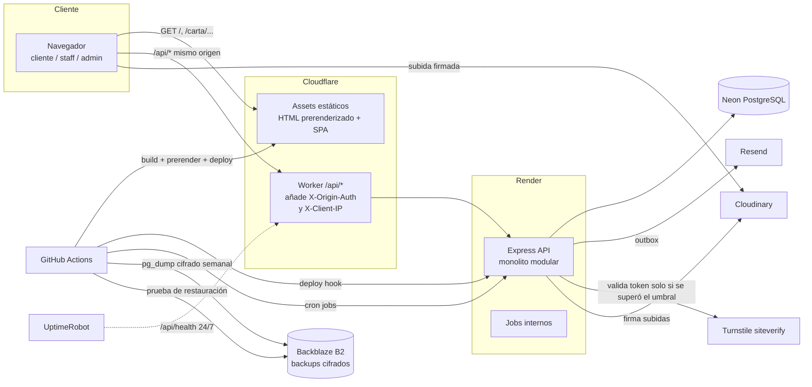
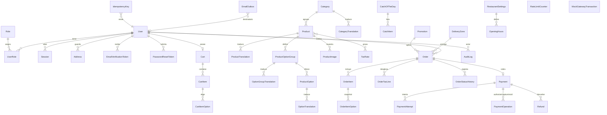
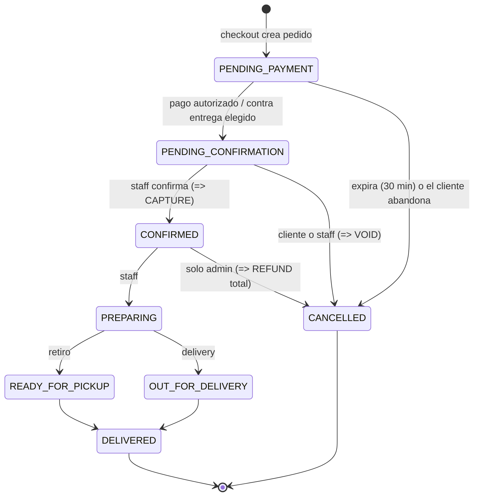
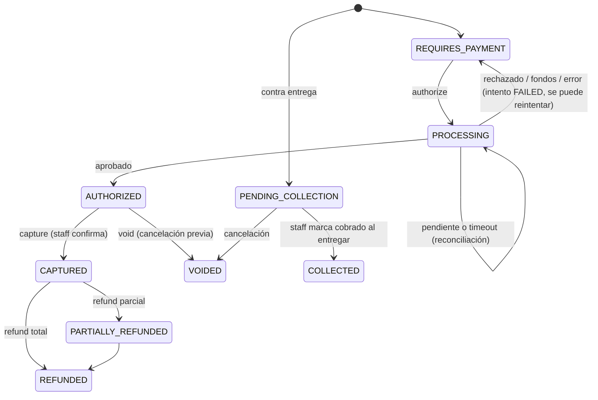
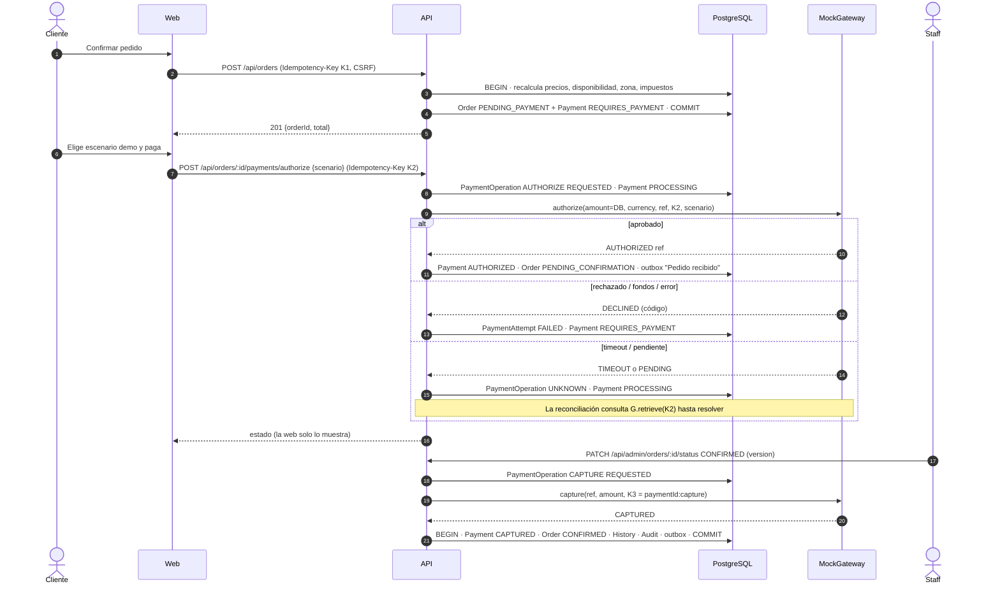
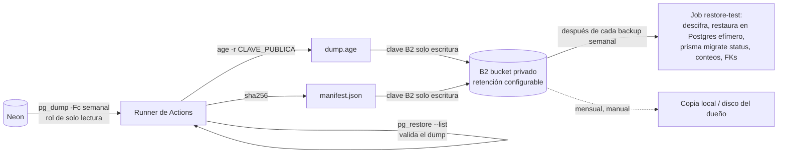

# Propuesta Restaurante · Fase 1 — Marea Baja

> **Versión 3 (decisiones de planificación aprobadas)** · 10 de noviembre de 2026
> **Estado:** planificación cerrada. **Las 14 decisiones pendientes de la versión 2 fueron aprobadas** (sección 15). **No hay código implementado** y la implementación todavía no comenzó. Todo lo que este documento describe es diseño aprobado para implementar, salvo lo marcado como verificado (fuentes consultadas), lo que sigue sin verificar (❓) y las validaciones técnicas de la sección 15.3.
> Historial: v1 (8/11, tres marcas) → v2 (9/11, Marea Baja consolidada) → v3 (10/11, decisiones D1–D14 aprobadas).
> Documentos relacionados: [AUDITORIA_COMPLETA_RESTAURANTE.md](AUDITORIA_COMPLETA_RESTAURANTE.md) · [PORTFOLIO_MASTER_PLAN.md](../../PORTFOLIO_MASTER_PLAN.md)
> Tablero visual del sistema de diseño (colores, tipografía, componentes y mockups): artefacto **Marea Baja · Sistema de diseño**.

**Convenciones:**

| Marca | Significado |
|---|---|
| ✅ Aprobado | Decisión que aprobaste. |
| 🟡 Pendiente | Necesitaba aprobación. En la v3 no queda ninguna decisión pendiente; el símbolo se mantiene solo en el historial. |
| D1–D14 | Referencia a una decisión aprobada de la sección 15. |
| 💡 Recomendación | Propuesta técnica mía, dentro de lo ya aprobado. |
| ⚠️ Riesgo / Limitación | Algo que puede fallar o que el proveedor restringe. |
| 🔎 Verificado | Dato confirmado en la fuente oficial indicada, el 9/11/2026. |
| ❓ A verificar | No pude confirmarlo; se verifica antes de configurar ese servicio. |
| 📌 Suposición | Algo que asumo y no confirmé. |

---

## Qué cambió en la versión 3

| Tema | Versión 2 | Versión 3 | Decisión |
|---|---|---|---|
| Sistema de diseño | Pendiente | Aprobado, con validaciones obligatorias: axe-core en todos los estados, glifos (tildes, ñ, ¿¡, ₡), legibilidad de precios en el celular, revisión nativa de 引潮 | D1 |
| Idiomas | Español, preparado para inglés | **es-CR por defecto + en desde la v1**, con SEO por idioma y `hreflang`, y traducción completa (carta, formularios, estados, admin y correos) | D2 |
| Pago sin cuenta | Recomendación | Carrito sin cuenta; **pago solo con cuenta verificada**; fusión del carrito invitado sin duplicar ni perder cantidades | D3 |
| Consumo en el local | Recomendación | Fuera de la app en la v1: sin reservas, sin mesas, sin pedidos para comer allí; `DINE_IN` inactivo | D4 |
| Fiscal | Suposición | Valores semilla aprobados: IVA 13 % incluido y servicio 10 % inactivo, configurables, con copia histórica por pedido | D5 |
| Correo | Escenario A o B | Resend (integración y pruebas) + Mailpit; **sin dominio ni correo de producción en esta fase** | D6 |
| Backups | Diarios + restauración semanal | **Ejecución automática semanal** en B2, con secretos de CI y pruebas periódicas de restauración. Ver la contradicción C1 | D7 |
| Turnstile | Pendiente | Aprobado, condicional al umbral global, validado en el backend | D8 |
| Monitoreo | Pendiente | UptimeRobot **24/7** con alertas de caída y recuperación | D9 |
| Prerender | 30 min, pendiente | 30 min configurable, sin ejecuciones innecesarias; precios y disponibilidad en tiempo real | D10 |
| Modo oscuro | Recomendación | Sin modo oscuro ni selector; arquitectura de tokens lista para un segundo tema | D11 |
| Web Design Guidelines | Pendiente | Aprobada su instalación (se hace al inicio de M1, no en esta tarea documental) | D12 |
| Fotografías | Preselección | Aprobación **foto por foto**, sin marcas de agua ni licencias dudosas | D13 |
| Cuentas externas | Pendiente | Las crea el propietario en M10, con guía paso a paso | D14 |

## Qué cambió en la versión 2 respecto de la versión 1

| Tema | Versión 1 | Versión 2 | Por qué |
|---|---|---|---|
| Marca | Tres opciones | ✅ **Marea Baja** | Tu elección. |
| Moneda | USD fija, impuesto 0 % | CRC por defecto, USD como alternativa; impuestos configurables con detalle fiscal guardado en cada pedido | Contexto Costa Rica (pedido tuyo). |
| SEO | SPA pura | **React Router en modo framework con `prerender` y `ssr:false`** | Las páginas públicas salen como HTML estático indexable, sin servidor de renderizado. |
| Pagos | Tarjetas de prueba completas | **Selector de escenarios demo**: no se pide ningún número de tarjeta | No se recopila nada parecido a un dato bancario. |
| Captura del pago | Ambigua | Autoriza en el checkout, **captura cuando el local confirma**, anula si se cancela antes, reembolsa si se cancela después | Corrige el diagrama de secuencia. |
| Rate limiting | En memoria | **Contadores persistentes en PostgreSQL** por IP, por cuenta y por cuenta+IP; demoras progresivas y bloqueos temporales | Sobrevive reinicios y no permite bloquear cuentas de forma permanente. |
| Backups | `pg_dump` como artefacto de Actions | `pg_dump` cifrado con `age`, guardado en bucket privado externo (Backblaze B2), con hash, restauración semanal de prueba y runbook | Los artefactos de un repo público no son un lugar seguro y no deben ser la única copia. |
| Auditoría | No existía | Entidad `AuditLog` de solo inserción, protegida en la base de datos | Pedido tuyo. |
| Imágenes | Cloudinary directo | Interfaz `ImageStorageProvider` con implementaciones Static, Cloudinary y R2 (alternativa) | Se puede cambiar de proveedor sin tocar la lógica de negocio. |
| Correos | Resend + Mailpit | Igual, más una **cola (outbox)** y estados que separan "enviado de verdad" de "notificación demo" | Nunca afirmar un envío que no ocurrió. |
| Proxy | Cloudflare `/api/*` | Igual, más un **secreto compartido** entre Worker y API y pruebas sobre el entorno desplegado | Evita saltear el proxy y falsificar IPs. |

---

## 1. Identidad definitiva de Marea Baja ✅

### 1.1 Concepto

**Marea Baja** es una cevichería nikkei (Perú × Japón) ficticia, ubicada en San José, Costa Rica.

- **Dirección ficticia:** "Calle 33, Barrio Escalante, San José — dirección ficticia de demostración". 📌 El barrio existe; el local no. Esto se aclara en el pie del sitio, en la página de contacto y en el README.
- **Eslogan:** «Lo que trajo el mar hoy».
- **Especialidades:** ceviches, tiraditos, bowls y makis.
- **Modalidades del restaurante:** consumo en el local, retiro y delivery propio.
- **Alcance de la app en la v1 (D4):** la aplicación toma pedidos **solo para retiro y delivery propio**. El consumo en el local se comunica como información (ubicación, horarios y contacto). No hay reservas, ni selección o asignación de mesas, ni pedidos para comer en el restaurante.
- **Personalidad:** serena, precisa, fresca y sofisticada.

**Dato propio que ancla la marca:** la **pizarra de pesca del día**. Cada mañana el local publica qué pescado entró y de qué puerto del Pacífico costarricense viene (por ejemplo, corvina de Puntarenas o pulpo del Golfo de Nicoya). Es contenido real del negocio, no decoración. Alimenta el hero, la carta (qué platos dependen de esa pesca) y la disponibilidad.

### 1.2 Paleta (conservada) y ajustes justificados

Contrastes calculados con la fórmula de luminancia relativa de WCAG 2.x.

| Token | HEX | Uso | Contraste clave |
|---|---|---|---|
| Tinta de mar | `#0F2E35` | Texto principal, bandas oscuras, botón primario | Sobre Espuma ≈ 12:1 |
| Espuma | `#EEF2EF` | Fondo general | — |
| Ají amarillo | `#F4B223` | CTA sobre fondo oscuro, foco sobre fondo oscuro | Sobre Tinta 7,6:1 ✔ · **Sobre Espuma 1,6:1 ✘ (nunca como texto sobre claro)** |
| Coral | `#D9573B` | Acento gráfico (hanko, ilustración) | Sobre Espuma 3,4:1: solo texto ≥ 24 px o elementos no textuales |
| Lima | `#C7D63A` | Resaltado puntual (etiqueta "pesca del día"), siempre con texto Tinta | Tinta sobre Lima 8,9:1 ✔ |
| Roca | `#5E6B6B` | Texto secundario, metadatos | Sobre Espuma 4,8:1 ✔ (AA texto normal) |

**Tokens derivados ✅ aprobados (D1)** (no reemplazan nada):

| Token | HEX | Motivo |
|---|---|---|
| Coral profundo | `#B8432A` | El Coral original no llega a 4,5:1 sobre Espuma. Este tono, de la misma familia, da ≈ 4,7:1 y sirve para **mensajes de error y texto pequeño de acento**. |
| Tinta 800 | `#173F48` | Hover del botón primario y bordes sobre fondo oscuro. |
| Sal | `#F8FAF8` | Superficies elevadas (paneles, hoja de producto) sobre Espuma, sin recurrir a blanco puro ni a sombras. |
| Línea | `#D5DDD9` | Divisores y bordes de campos en reposo (no textual; el borde de campos activos usa Roca para 3:1). |

Colores de estado: el éxito usa Tinta con un ícono de check y el texto "Confirmado", sin introducir un verde ajeno a la paleta. La advertencia usa Ají sobre Tinta. El error usa Coral profundo. El color nunca es la única señal: siempre va con texto o ícono.

> **Validación obligatoria (D1):** los contrastes de esta tabla son cálculos teóricos. Antes de dar por cerrado el sistema de diseño se miden en los componentes reales y en **todos sus estados** (reposo, hover, foco, activo, deshabilitado, error, cargando) con axe-core, más una revisión manual donde axe no alcanza (foco visible, texto sobre fotografía). Ver la sección 3.10.

### 1.3 Tipografía (conservada)

- **Shippori Mincho B1** (títulos). Serif de contraste alto, de tradición japonesa. Se usa solo de 22 px para arriba: en tamaños chicos sus trazos finos pierden legibilidad.
- **Zen Kaku Gothic New** (textos e interfaz). Sans humanista, legible a 15–17 px.
- **Licencia:** ambas son SIL Open Font License (Google Fonts). 💡 Se alojan en el propio sitio con **subconjuntos latinos** (latino y, si hace falta, latino extendido), sin los glifos CJK completos, que pesan varios MB. Así se evita además la dependencia de Google Fonts en tiempo de ejecución. La excepción son los dos caracteres del hanko 引潮, que se usan como **gráfico (SVG)**, no como texto con la fuente completa.
- **Verificación de glifos (D1, español e inglés por D2):** antes de cerrar M1 se comprueba en ambas fuentes, en los pesos usados: tildes (á é í ó ú, mayúsculas incluidas), ñ/Ñ, ü, ¿ ¡, comillas « » " ", raya —, símbolo **₡ (U+20A1)**, $ y separadores de cifras. ⚠️ No está verificado que las dos fuentes incluyan ₡; si falta, se documenta y se resuelve dentro del sistema aprobado (ver la validación V3 de la sección 15.3), sin cambiar las tipografías.
- **Cifras:** precios y totales con `font-variant-numeric: tabular-nums`, para que las columnas de precios se alineen como en una carta impresa.

### 1.4 Logotipo

- **Isotipo:** un **trazo continuo** que dibuja una ola y se cierra hacia abajo formando un bowl. Se construye con el mismo grosor de trazo que el asta de Shippori Mincho en el wordmark, para que logo y tipografía se vean como una sola pieza.
- **Wordmark:** "Marea Baja" en Shippori Mincho B1 ExtraBold, con versiones horizontal y apilada.
- **Hanko (secundario) ✅ se mantiene, con un rol acotado:** un sello cuadrado Coral con los caracteres **引潮** (*hikishio*, "marea baja / reflujo" en japonés). Aparece en tres lugares, porque ahí comunica algo: el **sello de frescura** de la pizarra de pesca del día, la **confirmación de pedido** y el packaging/OG. No se usa como decoración repetida.
  - ⚠️ **Requisito (D1):** un hablante nativo de japonés revisa la expresión 引潮 **antes de producción**. Hasta entonces, el hanko puede usarse en desarrollo, pero no se publica en el entorno público sin esa revisión.
- **Favicon:** solo el bowl-ola, que se lee mejor a 16 px que el hanko.
- **Reglas:** espacio libre alrededor igual a media altura del bowl; tamaño mínimo del isotipo de 24 px; nunca sobre fotografía sin una banda Tinta detrás.

---

## 2. Dirección artística ✅ aprobada (D1)

La dirección editorial nikkei queda aprobada tal como se describe aquí. La identidad visual no se rediseña ni se sustituye. Las validaciones de D1 (sección 3.10) comprueban que funcione, pero no la reemplazan.

### 2.1 Idea rectora: "la carta impresa de una barra nikkei"

El sitio se diseña como **una carta y un cuaderno de barra**, no como una landing de producto. Esa idea guía las decisiones:

- **Carta en lista editorial, no en grilla de tarjetas.** Nombre del plato en serif, descripción breve en sans, precio alineado a la derecha con cifras tabulares, y una línea de puntos opcional entre nombre y precio en escritorio. La foto aparece en la hoja del producto y en los platos destacados, no repetida en miniatura en cada fila.
- **Grilla asimétrica de 12 columnas.** Las fotos ocupan 7 columnas y los textos 4, con una columna de aire. Las secciones alternan alineación según el contenido, no por patrón fijo.
- **Bandas Tinta de ancho completo** para los momentos de marca (hero, pesca del día, visítanos). El resto vive sobre Espuma.
- **Línea de marea:** una línea horizontal fina que sube y baja es el único motivo gráfico recurrente. Se usa como divisor entre secciones y como **barra de progreso del pedido**. Ahí tiene función: cada "pleamar" es un estado.
- **Sin** gradientes decorativos, glassmorphism, sombras grandes, emojis ni íconos decorativos. Radios de 2 px en controles y 0 en fotografías; lo único circular es el bowl del logo.

### 2.2 Referencias visuales (patrones, no copias)

| Referencia | Patrón que tomo | Por qué aplica |
|---|---|---|
| Cartas impresas de barras nikkei de Lima (p. ej., la tradición de cartas de Maido o Osaka) | Jerarquía nombre → descripción → precio y agrupación por técnica (crudos, brasa, arroces) | Ayuda a pedir rápido y comunica oficio. |
| Pizarras de mercados de pescado (Tsukiji/Toyosu, Mercado Central de San José) | "Lo que entró hoy" con origen y hora | Es la base de la pizarra de pesca del día. |
| Tablas de mareas japonesas y costarricenses | Lectura tabular y una línea de nivel | Origen del motivo de línea de marea y del seguidor de pedidos. |
| Revistas gastronómicas editoriales (formato de suplemento de domingo) | Fotografía grande con pie de foto, columnas de texto angostas, mucho blanco | Le da una voz distinta a la de una plantilla. |
| Grabados *ukiyo-e* de olas | El trazo de ola como línea, no como ilustración llena | Fundamento del isotipo. |

Ninguna se reproduce. Son fuentes de patrones y su uso queda documentado.

### 2.3 Fotografía ✅ aprobada (D1, D13)

- **Fuente:** fotos reales de **Unsplash** o **Pexels**. 🔎 Ambas licencias permiten uso comercial sin atribución obligatoria ([Unsplash License](https://unsplash.com/license), [Pexels License](https://www.pexels.com/license/)).
- **Restricciones a respetar:**
  - No vender copias sin modificar.
  - No usar las fotos como marca o logotipo.
  - No sugerir respaldo de personas o marcas que aparecen en ellas.
  - No compilarlas para crear un servicio competidor (Unsplash).
  - Las imágenes **Unsplash+** tienen otra licencia y **se excluyen**.
- **No se usan fotos generadas por IA** como fotografías de comida. ✅
- **Proceso (D13):**
  1. Claude arma una preselección de 20–25 fotos. Cada opción incluye URL, autor, **fuente y condiciones de uso**, resolución original y una nota sobre composición.
  2. **El propietario aprueba cada fotografía de forma individual.** No se aprueban lotes completos por defecto.
  3. Antes de presentarla, verifico la licencia de cada foto en su propia página, no solo la del sitio en general.
  4. **Solo se descargan las fotos aprobadas.** Se registran autor, URL, fecha y licencia en `CREDITS.md`.
  5. Se revisa la resolución mínima (≥ 2000 px en el lado mayor para hero y galería, ≥ 1200 px para platos), la composición para los recortes de esta sección y la optimización (AVIF/WebP en variantes con nombre).
- **Exclusiones (D13):** imágenes con **marcas de agua**, con derechos de uso dudosos o no verificables, Unsplash+ y cualquier foto cuya página no muestre la licencia.
- **Criterios de selección:**
  - Luz natural y difusa, superficies de piedra, cerámica gris y madera clara.
  - Ángulos cenital o de 45°.
  - Platos plausibles para una cevichería nikkei (no hamburguesas renombradas).
  - Sin logos visibles.
  - Sin apariencia plástica ni bokeh excesivo.
  - Las fotos de personas o ambiente, sin estereotipos.
- **Tratamiento:**
  - Un único ajuste de color consistente (ligeramente frío, sombras levantadas hacia Tinta), aplicado en el pipeline de imágenes, no con filtros CSS.
  - Recortes de 4:5 (platos), 3:2 (ambiente), 1:1 (miniaturas de admin) y 1200×630 (Open Graph).
  - Texto alternativo que describe el plato, no "imagen de comida".
- ⚠️ **Limitación:** las fotos de stock no muestran *exactamente* los platos de la carta. La mitigación es elegir la carta en función de las fotos disponibles (y no al revés) y usar pies de foto honestos.

### 2.4 Contratos de diseño por pantalla

Formato del agente `design-ui-finish-gate-reviewer`. Al terminar cada pantalla se le aplica un "finish gate" (PASS/HOLD) con capturas a 375, 768, 1024 y 1440 px.

| Pantalla | Usuario y tarea | Lo primero que se lee | Acción principal | Densidad | Prohibido |
|---|---|---|---|---|---|
| Inicio | Cliente con hambre decidiendo qué pedir | Pesca del día y el plato estrella | "Ver la carta" / "Pedir" | Espaciosa | Hero genérico con texto vago, 3 tarjetas de "beneficios", testimonios inventados |
| Carta | Elegir y personalizar rápido | Nombre y precio por categoría | Abrir el plato / agregar | Equilibrada | Grilla de tarjetas iguales con foto, filtros que tapan la lista en el celular |
| Hoja de producto | Personalizar sin errores | Precio total actualizado con las opciones | "Agregar · ₡X" | Equilibrada | Modal centrado sin salida clara, precio que no se actualiza |
| Checkout | Pagar en el celular sin fricción | Resumen y total | "Pagar ₡X" | Compacta | Formularios largos en un solo bloque, errores solo en rojo |
| Seguimiento | Saber cuándo llega | Estado actual sobre la línea de marea | Ninguna (consultar) | Espaciosa | Barra de progreso genérica en porcentaje |
| Admin · Pase | Cocina/encargado moviendo pedidos | Pedidos que esperan confirmación y su antigüedad | Confirmar / avanzar estado | Compacta | Tablero de métricas genérico antes que el trabajo pendiente |

Cada contrato se valida en **los dos idiomas (D2)**: los textos en inglés suelen ser más cortos, y los nombres de platos y descripciones largas en español no deben romper la línea de carta ni los botones con precio.

---

## 3. Sistema de diseño ✅ aprobado con validaciones (D1) — detalle visual en el tablero

### 3.1 Escala tipográfica

Razón aproximada 1,25. Base de 16 px en el celular y 17 px en escritorio.

| Token | Celular | Escritorio | Fuente | Uso |
|---|---|---|---|---|
| `display` | 44/48 | 76/80 | Shippori 800 | Titular del hero (una vez por página) |
| `h1` | 34/40 | 52/58 | Shippori 800 | Título de página |
| `h2` | 28/34 | 38/44 | Shippori 600 | Sección |
| `h3` | 22/28 | 26/32 | Shippori 600 | Categoría de la carta, nombre del plato |
| `body-lg` | 18/28 | 19/30 | Zen Kaku 400 | Entradillas |
| `body` | 16/26 | 17/28 | Zen Kaku 400 | Texto |
| `ui` | 15/22 | 15/22 | Zen Kaku 500 | Botones, campos, navegación |
| `meta` | 13/18 | 13/18 | Zen Kaku 500, versalitas, +4 % de espaciado | Origen del pescado, etiquetas, fechas |
| `price` | 17/24 | 18/26 | Zen Kaku 700, cifras tabulares | Precios |

Texto corrido con un máximo de unos 65 caracteres por línea y títulos con `text-wrap: balance`.

### 3.2 Espaciado y grilla

- **Escala** (base 4): 4, 8, 12, 16, 24, 32, 48, 64, 96, 128.
- **Grilla:**
  - 4 columnas con medianil de 16 px (375).
  - 8 columnas con medianil de 24 px (768).
  - 12 columnas con medianil de 24 px (1024).
  - 12 columnas con medianil de 32 px y ancho máximo de 1280 px (1440).
- **Ritmo vertical entre secciones:** 64 px en el celular y 128 px en escritorio. Se reduce a la mitad entre bloques del mismo tema.

### 3.3 Botones y estados

| Variante | Sobre Espuma | Sobre Tinta | Uso |
|---|---|---|---|
| Primario | Fondo Tinta, texto Espuma | Fondo Ají, texto Tinta | Una acción principal por vista |
| Secundario | Borde de 1 px Tinta, texto Tinta | Borde de 1 px Espuma | Acciones alternativas |
| Texto | Subrayado de 1 px con desplazamiento | Igual en Espuma | Navegación secundaria |
| Peligro | Borde y texto Coral profundo | — | Cancelar pedido, reembolsar |

**Estados:**

- **Hover:** cambio de fondo en 150 ms.
- **Foco:** anillo de 2 px con 2 px de separación (Tinta sobre claro, Ají sobre oscuro); siempre visible con teclado.
- **Activo:** desplazamiento de 1 px.
- **Deshabilitado:** opacidad 0,45, más el motivo escrito cerca ("Elegí una salsa para continuar").
- **Cargando:** la etiqueta cambia a "Procesando…" y aparece una línea de progreso dentro del botón, que no cambia de ancho.
- **Altura mínima:** 48 px (44 px en el admin denso).

### 3.4 Campos y formularios

- Etiqueta siempre visible arriba; no se usa el placeholder como etiqueta.
- Ayuda debajo, borde de 1 px (Línea en reposo, Roca en hover, Tinta con foco), radio de 2 px y altura de 48 px.
- **Errores:**
  - Mensaje bajo el campo en Coral profundo, con ícono y texto.
  - `aria-describedby` y `aria-invalid`.
  - Al enviar con errores, **resumen enfocable** arriba del formulario con enlaces a cada campo (patrón de UI/UX Pro Max).
- Autocompletado correcto (`autocomplete="given-name"`, `tel`, `street-address`, etc.), teclado numérico para teléfono y validación al salir del campo y al enviar (no con cada tecla).
- Grupos de opciones de un plato:
  - `fieldset` + `legend`, con radios (elección única) o checkboxes (extras).
  - Diferencia de precio a la derecha ("+ ₡1.200").
  - Contador "elegí hasta 2" que se anuncia por `aria-live`.

### 3.5 Navegación

- **Escritorio:** barra superior fija y sobria. Wordmark a la izquierda; Carta · Pesca del día · Nosotros · Visítanos al centro; Cuenta y **"Pedido · 2 · ₡18.500"** a la derecha (el total a la vista es más útil que un ícono de carrito).
- **Celular:**
  - Barra superior con el wordmark y el botón de menú (hoja a pantalla completa).
  - Cuando hay productos en el pedido aparece una **barra inferior fija "Ver pedido · 2 · ₡18.500"**, que respeta `safe-area-inset-bottom` y se compensa con `scroll-padding` para que nunca tape el foco (WCAG 2.2 · 2.4.11).
- **Admin:** columna lateral Tinta con Pase · Pedidos · Carta · Clientes · Configuración · Auditoría; en tablet se colapsa a íconos con etiqueta.
- Enlace "Saltar al contenido" en todas las páginas.
- **Selector de idioma (D2):**
  - Dos enlaces de texto, "ES · EN", en la barra superior (dentro del menú en el celular), no una bandera ni un desplegable.
  - Cada enlace lleva `lang` y `hreflang`, apunta a **la misma página en el otro idioma** y marca el idioma actual con `aria-current`.
  - La preferencia se recuerda en una cookie no sensible y, para usuarios con cuenta, en `User.locale`.
  - El admin tiene el mismo selector.

### 3.6 Componentes principales

| Componente | Descripción breve |
|---|---|
| **Línea de carta** | Nombre (Shippori), descripción, etiquetas (Picante / Sin gluten / Vegetariano, solo con texto), precio, estado "Agotado hoy". |
| **Hoja de producto** | Panel que sube desde abajo en el celular y panel lateral en escritorio. Contiene foto 4:5, opciones, cantidad y botón con total en vivo. Foco atrapado y Escape para cerrar. |
| **Pizarra de pesca del día** | Banda Tinta con tabla de pescado, puerto y hora de entrada, más el hanko de frescura. Editable desde admin. |
| **Selector de cantidad** | Botones −/+ de 44 px con valor anunciado. Muestra y edita la **cantidad total** del producto: mínimo 1, **sin tope artificial de 20**. El límite de 20 solo aplica a las líneas internas de almacenamiento, que la API reorganiza automáticamente (regla C5, §7.5). Se respetan la disponibilidad del producto y las demás reglas comerciales. |
| **Línea de pedido** | Plato, opciones elegidas, cantidad, subtotal y acciones Editar / Quitar. |
| **Resumen de totales** | Subtotal, descuento, envío, impuestos (desglosados) y total, todo con cifras tabulares. |
| **Seguidor de pedido** | Línea de marea con los estados como marcas, estado actual con texto y hora, y anuncio por `aria-live`. |
| **Selector de escenario de pago demo** | Ver la sección 7. |
| **Estados vacíos** | Texto real y una acción ("Tu pedido está vacío. Hoy entró corvina de Puntarenas — Ver ceviches"). |
| **Esqueletos de carga** | Copian la forma real del contenido (líneas de carta), sin destellos animados si hay `prefers-reduced-motion`. |
| **Avisos (toasts)** | Abajo, sobrios y anunciados. Las acciones destructivas usan confirmación en línea, no solo un toast. |
| **Banner de demo** | Fijo y discreto arriba: "Demostración: no se procesa dinero real ni se envían pedidos a un local real". |
| **Admin · Pase** | Columnas por estado (Por confirmar, Confirmado, En preparación, Listo/En camino) con antigüedad del pedido, avance con un clic y atajos de teclado. |
| **Admin · editor de plato** | Formulario a la izquierda y vista previa en vivo de cómo se verá la línea de carta a la derecha. |

### 3.7 Movimiento

- **Duraciones:** 150 ms (hover), 250 ms (paneles) y 400 ms (una sola vez: el trazo del logo y la línea de marea del hero al cargar).
- **Curva:** `cubic-bezier(.2,.7,.2,1)`.
- Con `prefers-reduced-motion: reduce` se eliminan todas las transiciones de posición y el trazo aparece ya dibujado.
- No hay animaciones de entrada por scroll: todo el contenido es visible en reposo.

### 3.8 Escritorio vs. celular

- **Checkout optimizado para celular:**
  - Una columna con tres pasos: **Entrega → Datos → Pago**, más el resumen colapsable con el total siempre visible.
  - El botón "Pagar ₡X" queda fijo abajo.
  - El paso de entrega se recuerda.
- **Escritorio:** dos columnas (formulario y resumen fijo).
- **Admin en el celular:** pensado para que el encargado consulte y avance estados. La edición de carta y la configuración se optimizan para tablet y escritorio, pero siguen siendo usables a 375 px.

### 3.9 Tema único claro ✅ (D11)

- **Sin modo oscuro en la v1** y **sin selector de apariencia**. Solo se mantiene el tema claro, con sus bandas Tinta como parte de la identidad.
- El sitio no reacciona a `prefers-color-scheme`. Se declara `color-scheme: light` para que los controles nativos no cambien de color.
- **Preparación para el futuro:** los componentes usan **tokens semánticos** (`--surface`, `--text`, `--text-muted`, `--border`, `--accent-on-dark`, etc.) que apuntan a los colores de marca, nunca HEX sueltos. Un segundo tema solo tendría que redefinir esos tokens.
- Historial: en la v2 era una recomendación.

### 3.10 Validaciones obligatorias del sistema de diseño (D1)

| Validación | Cómo | Cuándo | Criterio de aceptación |
|---|---|---|---|
| Contraste real de componentes y estados | `@axe-core/playwright` sobre la página interna `/_design`, que muestra cada componente en cada estado, y sobre las pantallas reales | M1 (sistema) y M9 (pantallas) | 0 violaciones de contraste. Lo que axe no puede medir (texto sobre foto, anillo de foco) se revisa a mano con capturas |
| Glifos latinoamericanos y símbolos | Página de prueba con todos los caracteres de la sección 1.3, en ambas fuentes y en cada peso | M1 | Ningún carácter renderizado con la fuente de respaldo (comprobado con las herramientas de fuentes del navegador) |
| Estados, errores, foco y deshabilitados | Recorrido con teclado + lector de pantalla (NVDA en Windows) + axe | M1 y M9 | Foco siempre visible y no tapado; errores anunciados; deshabilitados con motivo legible |
| Legibilidad de precios y etiquetas en el celular | Capturas a 375 px en es y en en, con el precio más largo posible (por ejemplo ₡ 125.000) y la etiqueta más larga | M1 y M5 | Sin cortes, sin superposición, precio en `price` ≥ 17 px |
| Hanko 引潮 | Revisión de un hablante nativo | Antes de M10 (producción) | Confirmación escrita registrada en `CREDITS.md` o en el ADR de identidad |
| Fotografías | Aprobación individual (D13) | M1 | Cada foto con aprobación y licencia registradas |
| Apoyo de auditoría | Skill *Web Design Guidelines* (D12) | M1, M9 | Sus hallazgos se evalúan contra el sistema aprobado. **No lo modifican por sí solos** |

---

## 4. Arquitectura técnica ✅ (con las condiciones que pusiste)

### 4.1 Estructura (npm workspaces) ✅

```
restaurante/
├─ apps/
│  ├─ web/        React 19 + React Router (modo framework) + Vite + Tailwind v4
│  ├─ api/        Node 24 + Express 5 + Prisma
│  └─ edge/       Cloudflare Worker: proxy /api/* + assets estáticos
├─ packages/
│  └─ shared/     Esquemas Zod, tipos, enums de estados, utilidades de dinero puras, lista de idiomas
├─ docs/
└─ docker-compose.yml
```

💡 `apps/edge` es un paquete mínimo (un archivo de Worker y su configuración). Separarlo evita mezclar código de Cloudflare con la app React.

**Reglas de `packages/shared`:**

- **Contiene:** esquemas Zod de entrada y salida de la API, tipos derivados, enums de estados de pedido y pago, la tabla de transiciones permitidas (como datos), funciones de dinero puras (formateo y redondeo) y la lista de idiomas soportados (`es-CR`, `en`) con el predeterminado. **No contiene los textos traducidos**: esos viven en cada app (sección 4.5).
- **No contiene:** acceso a la base de datos, Express, React, llamadas de red, variables de entorno ni lógica de negocio con efectos secundarios.
- **Única dependencia de ejecución:** `zod`.
- 💡 La tabla de transiciones vive en `shared` para que la UI muestre solo los botones válidos, pero **la validación que decide es la del backend**, que la importa y la aplica dentro de la transacción.

### 4.2 Frontend y SEO ✅ (condición resuelta)

**Opción elegida:** React Router v7 en **modo framework** (su plugin de Vite) con `ssr: false` + `prerender`. 🔎 [Documentación oficial de pre-rendering](https://reactrouter.com/how-to/pre-rendering).

| Aspecto | Cómo funciona |
|---|---|
| Qué se prerenderiza | **En cada idioma (D2):** `/`, `/carta`, `/carta/:categoria`, `/carta/:categoria/:plato`, `/nosotros`, `/visitanos` (es-CR, sin prefijo) y sus equivalentes con prefijo `/en/` y segmentos traducidos (`/en/menu/...`, `/en/about`, `/en/visit`). Las rutas dinámicas se obtienen en build con la función `prerender({ getStaticPaths })`, que consulta la API pública del catálogo. |
| Salida | Por cada ruta y cada idioma, un `index.html` (HTML completo para buscadores y primera carga) y un `.data` (navegación del lado del cliente). 🔎 |
| Rutas no listadas | `/cuenta/*`, `/pedido/*`, `/admin/*` y sus equivalentes `/en/...` usan el **fallback SPA** (`__spa-fallback.html`). 🔎 Llevan `noindex`. |
| Metadatos | Export `meta` por ruta **y por idioma**: `title`, `description`, `canonical` (cada idioma es su propia URL canónica), `<link rel="alternate" hreflang="es-CR">`, `hreflang="en"` y `hreflang="x-default"` (apunta a es-CR), Open Graph (`og:title`, `og:description`, `og:image` 1200×630, `og:type`, `og:locale` `es_CR` / `en_US` con `og:locale:alternate`) y Twitter card. `<html lang>` correcto en cada página. |
| Datos estructurados | JSON-LD `Restaurant` (horarios, dirección ficticia, `servesCuisine`) y `Menu` / `MenuSection` / `MenuItem` con precios en CRC, generados en el idioma de la página. |
| `sitemap.xml` y `robots.txt` | Se generan en el mismo build con la lista de rutas prerenderizadas de ambos idiomas, con anotaciones `xhtml:link` de alternativas por idioma. `robots.txt` bloquea `/admin`, `/cuenta`, `/pedido` y sus equivalentes en `/en/`. |
| Slugs de platos | Los nombres originales de los platos se mantienen (D2), así que el **slug del plato es el mismo en los dos idiomas** y solo cambian los segmentos fijos (`carta` → `menu`). Por ejemplo, `/carta/ceviches/ceviche-clasico` ↔ `/en/menu/ceviches/ceviche-clasico`. |
| Frescura (D10) | **Precios y disponibilidad no dependen del prerender.** Al hidratar, la carta, la hoja de producto y el carrito **consultan la API en tiempo real** y muestran el dato vivo. Si el producto se agotó, lo marcan. El HTML prerenderizado sirve para buscadores y para la primera carga. El carrito y el checkout siempre validan contra el servidor. |
| Rebuild ✅ (D10) | Un workflow programado de GitHub Actions corre cada **30 min**. Consulta `GET /api/public/catalog-version` y lo compara con la versión publicada; **solo reconstruye si cambió**, para evitar ejecuciones innecesarias. También se puede lanzar a mano. La API no necesita tokens de GitHub. La frecuencia es **configurable editando el `schedule` del workflow** (C6), sin mecanismos ni infraestructura adicionales. ⚠️ GitHub puede retrasar las ejecuciones programadas, así que el desfase para buscadores es el intervalo configurado más ese posible retraso. |

**Implicaciones técnicas que debés conocer:**

1. El "modo framework" usa módulos de ruta (`loader`, `meta`, `clientLoader`). Es otra forma de escribir rutas que el modo librería (`createBrowserRouter`), pero sigue siendo React Router sobre Vite.
2. Con `ssr: false`, los `loader` corren **solo en build** y los exports `headers`/`action` están prohibidos. 🔎 Las mutaciones se hacen con TanStack Query contra la API.
3. El build necesita que la API esté accesible. Con el monitor 24/7 (D9) la API debería estar despierta; aun así, el build reintenta si no responde.
4. 💡 `catalog-version` se sirve desde **memoria** en la API y se invalida con cada cambio de catálogo hecho desde el admin. Así la consulta cada 30 min **no despierta la base de datos** (ver el riesgo R20). Al reiniciar la API, la primera consulta lee la base una vez.
5. Con dos idiomas se prerenderiza el doble de páginas. Con una carta de unos 40 platos son alrededor de 100 rutas, muy por debajo de los límites de archivos de Cloudflare (20.000). 🔎

**Alternativas evaluadas:**

| Alternativa | Motivo para descartarla |
|---|---|
| `vite-plugin-ssr` / Vike | Otra abstracción más. |
| `react-snap` / Puppeteer | Frágil y sin mantenimiento activo. |
| SSR real en Render | Agrega arranques en frío al HTML y requiere servidor. |
| Next.js | Reservado para el proyecto SaaS. Usarlo aquí rompe la diversidad del portafolio. |

### 4.3 Backend: capas y módulos

```
apps/api/src/
├─ config/        env validado con Zod, logger, prisma
├─ middleware/    requestId, sesión, csrf, rbac, rateLimit, originAuth, errores
├─ modules/
│  ├─ auth/       routes · controller · service · repository · schemas
│  ├─ catalog/
│  ├─ cart/
│  ├─ pricing/    motor de precios e impuestos (puro, sin I/O)
│  ├─ orders/     máquina de estados
│  ├─ payments/   orquestación + interfaz PaymentGateway
│  ├─ mock-gateway/  "procesador externo" simulado, con sus propias tablas
│  ├─ notifications/ EmailProvider + outbox + plantillas (es-CR y en)
│  ├─ bot-check/  verificación de Turnstile en el servidor (D8)
│  ├─ media/      ImageStorageProvider
│  ├─ admin/      dashboard, clientes, configuración
│  └─ audit/      AuditLog
└─ jobs/          barridos: outbox, expiración de pedidos, reconciliación de pagos, limpieza de rate limit
```

- **Controladores:** traducen HTTP ↔ DTO.
- **Servicios:** contienen la lógica de negocio y abren transacciones.
- **Repositorios:** solo donde aportan (consultas complejas del dashboard y del pase).
- 💡 **Jobs sin servidor de colas:** se ejecutan con un `setInterval` liviano dentro de la API mientras está despierta, más un endpoint protegido `POST /internal/jobs/run` que el cron de GitHub Actions llama cada 15 min. No hace falta Redis.

### 4.4 Justificación de tecnologías

| Tecnología | Rol | Por qué | Alternativa |
|---|---|---|---|
| TypeScript | Todo | Tipos compartidos de punta a punta | JavaScript con JSDoc |
| React 19 | UI | Pedido del portafolio y el ecosistema más amplio | Vue, Svelte |
| React Router v7 (framework) | Rutas, prerender, meta | SEO sin servidor | TanStack Router + prerender propio |
| Vite | Build | Rápido y estándar | — |
| Tailwind CSS v4 | Estilos | Tokens como variables CSS y sin CSS muerto. Se usa con **clases de componente propias** para no caer en markup de plantilla | CSS Modules |
| TanStack Query | Datos remotos | Caché, reintentos y estados de carga y error | SWR |
| React Hook Form + Zod | Formularios | Mismos esquemas que el backend | Formik |
| Node 24 + Express 5 | API | Pedido. Express 5 propaga errores async | Fastify, Hono |
| PostgreSQL 17 | Datos | Transacciones, `CHECK`, índices parciales, triggers (para AuditLog) | — |
| Prisma | ORM y migraciones | Tipos, migraciones versionadas, consultas parametrizadas. SQL crudo solo con `$queryRaw` etiquetado (parametrizado) | Drizzle |
| Zod | Validación | Única fuente de verdad en `shared` | Valibot |
| `@node-rs/argon2` | Contraseñas | Argon2id con binarios precompilados (funciona en Windows) | bcrypt |
| Pino | Logs | JSON rápido con redacción | Winston |
| Resend / Mailpit | Correo | API HTTPS (Render bloquea SMTP) / captura local | Amazon SES |
| Cloudinary / estáticos | Imágenes | Ver la sección 9.4 | R2 |
| Cloudflare Workers | Hosting web + proxy | Assets gratis e ilimitados 🔎 | Netlify |
| Render | API | Free con limitaciones (sección 9) | Plan pago de Render, Cloud Run |
| Neon | PostgreSQL | Free permanente que no borra datos 🔎 | Supabase |
| Vitest, Supertest, Playwright, axe-core | Pruebas | Sección 11 | Jest, Cypress |
| Docker Compose | Entorno local | Postgres + Mailpit + API con un comando | — |
| GitHub Actions | CI/CD, cron, backups | Integrado al repo | — |
| `age` | Cifrado de backups | Simple, moderno, claves cortas | GPG |
| Cloudflare Turnstile ✅ (D8) | Desafío anti-bots condicional | Gratis e ilimitado, sin requerir otros servicios de Cloudflare 🔎 | hCaptcha |
| Biblioteca de i18n (D2) | Textos centralizados, plurales, formatos | Se elige en M1 entre opciones maduras para React (por ejemplo react-i18next o Lingui) y se documenta en un ADR. Es una decisión técnica menor dentro de D2 | — |
| `Intl` (nativo) | Fechas, monedas y números por idioma | Sin dependencias | — |

### 4.5 Internacionalización ✅ (D2)

| Aspecto | Diseño |
|---|---|
| Idiomas | `es-CR` predeterminado y `en` **disponible desde la v1**. La lista vive en `packages/shared`. |
| Textos de la interfaz | **Centralizados** en archivos de mensajes por idioma (`apps/web/src/i18n/es-CR/*.json`, `.../en/*.json`), organizados por área: carta, formularios, estados, errores, admin. **No hay cadenas incrustadas en componentes.** Una regla de lint y un test de CI fallan si aparece texto literal en JSX o si a un idioma le falta una clave del otro. |
| Mensajes de la API | La API devuelve **códigos** de error y de estado (`ORDER_NOT_FOUND`, `PAYMENT_DECLINED_INSUFFICIENT_FUNDS`); la web los traduce. Los mensajes legibles que genera la API (correos) usan sus propias plantillas por idioma. |
| Contenido del catálogo | **Nombres originales de los platos se mantienen** ("Tiradito nikkei", "Ceviche clásico"). Las descripciones, las categorías, los grupos y las opciones se traducen. Un campo opcional de nombre en inglés existe solo para cuando corresponde (por ejemplo, un plato con nombre descriptivo en español). Las traducciones se editan en el admin junto al texto en español. |
| Datos | Tablas de traducción por entidad (sección 6.1): el texto en `es-CR` es la fuente y `en` lo acompaña. Si falta una traducción, se muestra el texto en español marcado con `lang="es"` para que los lectores de pantalla lo pronuncien bien, y el admin lo señala como pendiente. |
| Correos | Plantillas completas en ambos idiomas. Se envían en `User.locale`, que se toma del idioma activo al registrarse y puede cambiarse en el perfil. |
| Admin | Interfaz completa en ambos idiomas. |
| Formatos | `Intl.NumberFormat` y `Intl.DateTimeFormat` por idioma. La moneda la define el negocio (CRC por defecto), no el idioma: un visitante en inglés ve los precios en colones. Ver la validación V4 sobre el formato exacto de es-CR. |
| Pedidos | El `OrderItem` copia el nombre original y la descripción de las opciones en el idioma en que se hizo el pedido, más la versión es-CR para el admin. Un pedido histórico no cambia si después se edita una traducción. |
| SEO | Sección 4.2: URL y metadatos por idioma, `hreflang`, sitemap con alternativas. |
| Selector | Sección 3.5. |

---

## 5. Diagrama de arquitectura



**Reglas del proxy ✅:**

- El Worker solo se ejecuta para `/api/*`. El resto se sirve como asset estático, gratis y sin contar invocaciones del Worker. 🔎 ([Static assets billing](https://developers.cloudflare.com/workers/static-assets/billing-and-limitations/))
- El Worker agrega `X-Origin-Auth: <secreto>`. La API rechaza con 403 cualquier petición sin ese secreto, así que llamar directo a `*.onrender.com` no sirve.
- La IP del cliente se toma de `CF-Connecting-IP` en el Worker y viaja como `X-Client-IP`. La API **solo** confía en ese encabezado cuando el secreto es válido.
- CORS: con mismo origen, la API **no** habilita CORS para orígenes externos. Lista blanca vacía en producción; `localhost:5173` solo en desarrollo.

---

## 6. Diagrama de base de datos (actualizado)



### 6.1 Entidades nuevas o cambiadas

| Entidad | Campos clave | Notas |
|---|---|---|
| `Session` | `tokenHash` (único), `csrfSecret`, `createdAt`, `lastSeenAt`, `idleExpiresAt`, `absoluteExpiresAt`, `rotatedAt`, `revokedAt`, `ipHash`, `userAgent` | Ver la sección 8 |
| `RestaurantSettings` | `currency` (`CRC`/`USD`), `pricesIncludeTax`, `roundingIncrementMinor`, `minOrderMinor`, `pickupEnabled`, `deliveryEnabled`, `timezone` (`America/Costa_Rica`), `isDemo`, `version` | Una sola fila |
| `TaxRate` | `name`, `rateBps` (1300 = 13,00 %), `appliesTo` (`ITEMS`/`DELIVERY`/`BOTH`), `fulfillmentTypes`, `isActive` | Configurable desde admin |
| `OrderTaxLine` | `name`, `rateBps`, `inclusive`, `taxableBaseMinor`, `taxMinor` | **Copia histórica** del detalle fiscal |
| `Order` | `code`, `status`, `fulfillmentType`, `currency`, `currencyMinorUnits`, `subtotalMinor`, `discountMinor`, `deliveryFeeMinor`, `taxTotalMinor`, `roundingAdjustmentMinor`, `totalMinor`, `pricesIncludeTax`, `version` (concurrencia optimista), `expiresAt` | Todos los montos en enteros |
| `Payment` | `method` (`DEMO_CARD`/`CASH_ON_DELIVERY`), `status`, `amountAuthorizedMinor`, `amountCapturedMinor`, `amountRefundedMinor`, `currency` | Uno por pedido |
| `PaymentAttempt` | `idempotencyKey`, `demoScenario`, `result`, `failureCode`, `gatewayRef`, `createdAt` | Historial de intentos |
| `PaymentOperation` | `type` (`AUTHORIZE`/`CAPTURE`/`VOID`/`REFUND`), `status` (`REQUESTED`/`SUCCEEDED`/`FAILED`/`UNKNOWN`), `idempotencyKey` | Base de la reconciliación |
| `Refund` | `amountMinor`, `reason`, `idempotencyKey` (único), `actorUserId` | Total o parcial |
| `MockGatewayTransaction` | `ref`, `idempotencyKey`, `amountMinor`, `currency`, `state`, `scenario`, `resolveAt` | Tablas del "procesador"; el módulo de pagos nunca las lee directamente |
| `IdempotencyKey` | `key`, `scope`, `userId`, `requestHash`, `responseStatus`, `responseBody`, `lockedUntil`, `expiresAt` | Único `(scope, key)` |
| `RateLimitCounter` | `key`, `windowStart`, `count` | PK `(key, windowStart)` |
| `LoginLock` | `subjectKey` (cuenta+IP o cuenta), `lockedUntil`, `level` | Bloqueos temporales escalonados |
| `EmailOutbox` | `template`, `to`, `payload`, `status` (`QUEUED`/`SENT`/`DEMO_ONLY`/`FAILED`), `providerMessageId`, `attempts`, `lastError` | Sección 8.5 |
| `AuditLog` | Sección 8.6 | Solo inserción |
| `CatchOfTheDay` / `CatchItem` | `date`, `species`, `port`, `arrivedAt` | Pizarra de pesca del día |
| `ProductImage` | `provider`, `storageKey`, `width`, `height`, `alt` (por idioma, en la tabla de traducción), `sortOrder` | **No guarda URL completa** |
| `User` (cambio, D2/D3) | Se agregan `locale` (`es-CR`/`en`) y `emailVerifiedAt` | Pagar exige `emailVerifiedAt` no nulo (D3) |
| `CategoryTranslation`, `ProductTranslation`, `OptionGroupTranslation`, `OptionTranslation` (D2) | `locale`, `description`, nombre traducido opcional (solo categorías, grupos y opciones; en platos, solo si corresponde), `altText` | Único `(entidadId, locale)`. El texto `es-CR` vive en la entidad principal |
| `Cart` (cambio, D3) | `userId` (obligatorio: en el servidor solo hay carritos de cuentas; el carrito de invitado vive en el navegador), `lastMergeKey`, `mergedAt` | Ver la sección 7.5 |
| `OrderItem` / `OrderItemOption` (cambio, D2) | `orderLocale`, nombre original, etiqueta de opción en el idioma del pedido y en es-CR | Copia histórica |
| `EmailOutbox` (cambio, D2) | `locale` | La plantilla se elige por idioma |
| `RestaurantSettings` (cambio, D8) | `turnstileGlobalThreshold`, `turnstileWindowMinutes` | Umbral configurable desde admin (con valores por defecto en env) |

### 6.2 Dinero, moneda e impuestos

> ⚠️ Lo que sigue es **configuración de software para una demo**. No es asesoramiento tributario **ni una certificación de cumplimiento fiscal**. Los valores semilla fueron aprobados como parámetros de la demostración (D5) y deben validarse con un profesional si el sistema se usara en un negocio real.

1. **Unidades enteras:**
   - Todos los montos se guardan como enteros en la **unidad menor ISO 4217** de la moneda: céntimos para CRC (2 decimales) y centavos para USD (2 decimales).
   - Un registro `CURRENCIES` en `shared` define `minorUnits` y el `roundingIncrementMinor` por defecto: CRC = 100 (se cobra al colón entero, como es la práctica en precios), USD = 1.
2. **Moneda activa:** `RestaurantSettings.currency`. Cada pedido guarda su propia `currency` y no cambia aunque luego cambie la configuración.
3. **Cambio de moneda:** no es un interruptor. Se hace con un **asistente de admin** que:
   - exige que no haya pedidos activos;
   - pide un tipo de cambio o un precio por producto;
   - recalcula precios, opciones, tarifas de zonas y pedido mínimo en una transacción;
   - registra todo en `AuditLog`.
4. **Tasas** en puntos básicos (`rateBps`), configurables en admin. **No se asume 0 %.**
   - **Valores semilla aprobados (D5):** **IVA 13 %** sobre productos y envío, **incluido en los precios mostrados** (`pricesIncludeTax = true`).
   - **Cargo de servicio del 10 %:** se modela como `TaxRate` aplicable **solo** a `DINE_IN` y queda **inactivo** (D4, D5). Como la app no toma pedidos para consumir en el local, ese tipo de entrega no existe en los pedidos (ver la contradicción C10).
   - Todo es **configurable desde el admin**, con registro en `AuditLog`. Cada pedido conserva una copia de los valores usados al crearse (punto 6).
5. **Algoritmo** (puro, en `modules/pricing`, cubierto por tests de tabla):
   1. Precio de línea = (precio base + Σ opciones) × cantidad.
   2. Los descuentos se distribuyen proporcionalmente entre líneas con el **método del mayor resto**, para que la suma cierre exactamente.
   3. Se agrupan las bases imponibles por tasa.
   4. **Impuesto incluido:** `tax = round(base × r / (1 + r))`. **No incluido:** `tax = round(base × r)`.
   5. Redondeo **half-up (alejándose de cero)** a la unidad menor, **una vez por tasa y por pedido**, no por línea. Así se evita la acumulación de errores.
   6. El total se redondea al `roundingIncrementMinor` de la moneda y la diferencia se guarda en `roundingAdjustmentMinor`, a la vista en el detalle.
6. **Histórico:** `OrderItem` y `OrderItemOption` copian nombres y precios; `OrderTaxLine` copia nombre, tasa, base e impuesto. Un cambio posterior de tasas o precios no altera pedidos pasados.

### 6.3 Índices y restricciones (resumen)

- **Únicos:**
  - `lower(User.email)` (índice funcional por SQL de migración).
  - `Product.slug`, `Category.slug`, `Order.code`.
  - `IdempotencyKey(scope, key)` y `Refund.idempotencyKey`.
  - `Payment.orderId`.
- **`CHECK`:** montos ≥ 0, cantidad entre 1 y 20 **por línea interna** de `CartItem` y `OrderItem` (no es un tope de la cantidad total del producto; ver la regla C5, §7.5), `rateBps` entre 0 y 10000, `amountRefunded ≤ amountCaptured ≤ amountAuthorized`.
- **Índices:** `Order(status, createdAt)`, `Order(userId, createdAt)`, `Product(categoryId, isActive)`, `AuditLog(entityType, entityId, createdAt)`, `RateLimitCounter(windowStart)` (limpieza) y `EmailOutbox(status, createdAt)`.

---

## 7. Flujo de pedidos y pagos (corregido)

### 7.1 Máquina de estados del pedido



- `PENDING_PAYMENT` es interno: no aparece en el Pase ni dispara correos. Lo pediste como mínimo de seis estados visibles y se mantienen los seis.
- Si un pedido no se confirma en 20 min, el job lo cancela y **anula** la autorización (configurable).
- **Quién puede hacer cada transición:**

  | Rol | Transiciones permitidas |
  |---|---|
  | `CUSTOMER` | Solo `PENDING_CONFIRMATION → CANCELLED`, y únicamente sobre sus propios pedidos. |
  | `STAFF` | Avance operativo. |
  | `ADMIN` | Todo, más la cancelación post-confirmación. |

- **Cada transición** ocurre en una transacción que:
  1. hace `UPDATE … WHERE id = $1 AND version = $2` (si otra persona cambió el pedido, la operación falla con 409 y se recarga);
  2. inserta `OrderStatusHistory` (de, a, actor, motivo, fecha);
  3. inserta `AuditLog` si el actor es staff o admin;
  4. encola el correo en `EmailOutbox`.

### 7.2 Máquina de estados del pago



**Relación entre las operaciones:**

- **`authorize`** reserva el monto en la "tarjeta" demo. Ocurre en el checkout. El monto **se lee del pedido en la base de datos**, nunca del body.
- **`capture`** cobra lo autorizado. Ocurre **cuando el local confirma el pedido** (`PENDING_CONFIRMATION → CONFIRMED`), porque en ese momento el local se compromete a cocinar. Si la captura falla, el pedido **no** pasa a `CONFIRMED` y el Pase muestra el error para reintentar.
- **`void`** libera una autorización no capturada. Ocurre al cancelar antes de confirmar.
- **`refund`** devuelve dinero ya capturado, total o parcial. Solo admin. Debe cumplirse que Σ reembolsos ≤ capturado, con bloqueo `SELECT … FOR UPDATE` sobre el pago.

### 7.3 Secuencia completa (con la captura explícita)



**Consistencia ante errores y reintentos:**

1. **Idempotencia HTTP:**
   - `POST /orders`, `/authorize` y `/refunds` exigen el encabezado `Idempotency-Key` (UUID generado en el cliente por intento de acción).
   - La API guarda `requestHash` y la respuesta. Si la misma clave llega con el mismo cuerpo, devuelve la respuesta original; con otro cuerpo, devuelve **422**.
   - Mientras la primera petición se procesa, la clave queda bloqueada (`lockedUntil`) y una segunda concurrente recibe **409**.
2. **Idempotencia del gateway:** cada operación usa una clave determinística (`paymentId:capture`, `paymentId:void`, `refundId`). Reintentar nunca cobra dos veces.
3. **Intención antes de la llamada externa:** se registra `PaymentOperation REQUESTED` antes de llamar al gateway. Si la API se cae a mitad de camino, el job de reconciliación encuentra las operaciones `REQUESTED`/`UNKNOWN` y las reintenta con la misma clave.
4. **Pagos duplicados:**
   - Hay un solo `Payment` por pedido (único).
   - `authorize` solo se acepta en `REQUIRES_PAYMENT`.
   - Mientras está en `PROCESSING`, otro intento recibe 409.
5. **Pedido duplicado:** misma `Idempotency-Key`, o el mismo usuario con un carrito idéntico en menos de 60 s, devuelve el pedido existente.
6. **Producto no disponible:** se revalida dentro de la transacción de creación. Si algo se agotó, se responde 409 con la lista de líneas afectadas y la UI ofrece quitarlas.

### 7.4 Pasarela simulada y selector de escenarios ✅

- **No hay campos de tarjeta.** El paso de pago muestra un **selector de escenarios demo** (radio buttons con explicación):
  - Aprobado.
  - Rechazado.
  - Fondos insuficientes.
  - Error del procesador.
  - Tiempo agotado.
  - Pendiente: se resuelve en unos 20 s y en pantalla se ve cómo cambia el estado.
- **Lo que el selector controla y lo que no:**
  - El escenario es solo una **entrada** que la API valida contra una lista cerrada (`enum` Zod) y que solo acepta si `DEMO_PAYMENTS_ENABLED=true`.
  - Monto, moneda, estado, transiciones e idempotencia los decide el backend.
  - El frontend no puede marcar nada como pagado: no existe ningún endpoint que reciba un estado.
- La UI muestra una "tarjeta demo" fija (**DEMO •••• 0000**) como ilustración. **No se guarda** número, CVV ni vencimiento, porque nunca se piden.
- **Modo "Tiempo agotado":** el mock **sí autoriza internamente** pero responde timeout. Así se demuestra que la reconciliación encuentra la autorización y evita un segundo cobro. Es un caso clásico de pagos reales.
- **Pago contra entrega:** no pasa por el gateway. El staff lo marca como `COLLECTED` al entregar.
- **Mensajes al usuario:** claros y sin culpas. Por ejemplo: "El banco demo rechazó el pago por fondos insuficientes. Podés probar otro escenario; tu pedido sigue reservado 30 min."
- **Banner permanente:** "Entorno de demostración: no se procesa dinero real".
- El módulo `mock-gateway` es un "proveedor" detrás de la interfaz `PaymentGateway { authorize, capture, void, refund, retrieve }`. Para usar Stripe en otro proyecto bastaría otra implementación.

### 7.5 Carrito de invitado, cuenta verificada y fusión ✅ (D3)

**Reglas:**

- Se puede **explorar la carta y agregar productos sin iniciar sesión**.
- **Para pagar hace falta una cuenta con el correo verificado.** `POST /api/orders` y `/authorize` rechazan con `403 EMAIL_NOT_VERIFIED` a usuarios no verificados, y con 401 a invitados.
- La UI lo anticipa:
  - Al tocar "Pagar" sin sesión, ofrece "Iniciar sesión" o "Crear cuenta" y **conserva el carrito**.
  - Si la cuenta no está verificada, muestra la pantalla de verificación con el botón de reenvío, sujeto a los límites de la sección 8.4.
- Todos los pedidos quedan asociados a la cuenta y aparecen en su historial y en el seguimiento (sección 3.6).

**Dónde vive el carrito:**

| Situación | Almacenamiento |
|---|---|
| Invitado | `localStorage`, solo con referencias (`productId`, ids de opciones, cantidad). **Sin precios**: los precios siempre se piden a la API. |
| Con sesión | Tabla `Cart` en PostgreSQL, sincronizada con la API. |
| Al iniciar sesión o registrarse | Se fusiona el carrito del navegador con el de la cuenta. |

**Fusión sin duplicar ni perder cantidades:**

1. La web envía `POST /api/cart/merge` con las líneas del carrito invitado y una `mergeKey` (UUID generado una vez por carrito invitado).
2. La API, en una transacción:
   - Si `mergeKey == Cart.lastMergeKey`, ya se fusionó: devuelve el carrito actual sin tocar nada. **Así un reintento o un doble envío no duplica cantidades.**
   - Agrupa las líneas por **identidad de línea** = `productId` + conjunto **ordenado** de opciones elegidas. Dos líneas con el mismo plato y las mismas opciones son la misma línea, aunque las opciones se hayan elegido en otro orden.
   - Para la misma identidad, **suma** las cantidades (no toma el máximo ni sobrescribe).
   - Líneas con productos u opciones desactivados o no disponibles: no se descartan en silencio. Se devuelven en `unavailable[]` para que la UI las muestre con su motivo.
   - Guarda `lastMergeKey` y `mergedAt`.
3. La web borra el carrito del navegador **solo cuando** recibe la respuesta correcta. Si falla, lo conserva y reintenta con la misma `mergeKey`.
4. **Cantidad total y líneas internas ✅ (regla definitiva de C5, 10/11/2026):**
   - **El límite de 20 unidades es de almacenamiento:** se aplica a cada **línea interna** (restricción `CHECK`, §6.3), **no a la cantidad total** de un producto que gestiona el cliente.
   - **El cliente gestiona la cantidad total:** en la interfaz puede **aumentarla y reducirla sin un tope artificial de 20**.
   - **División automática en bloques de hasta 20:** cada vez que cambia el total, la API reorganiza las líneas internas, siempre en la misma identidad de línea (`productId` + opciones ordenadas):
     - 15 unidades → una línea de 15.
     - 25 unidades → 20 + 5.
     - 47 unidades → 20 + 20 + 7.
     - Si el cliente sube de 25 a 30 → se reorganiza a 20 + 10.
   - **Presentación única:** el carrito, el checkout, la confirmación, el historial y el seguimiento muestran **siempre un único producto con su cantidad total** (30, no "20" y "10"). El admin también lo ve agrupado. El agrupamiento usa la identidad de línea, así que no hace falta una columna nueva.
   - **Fusión idempotente:** la división se hace **dentro de la misma transacción** que la fusión o la edición, y respeta la idempotencia del paso 2: la misma `mergeKey` no vuelve a sumar. **Nunca se pierden, duplican ni reducen cantidades**: la suma de las líneas internas es siempre igual al total esperado, y eso se verifica con tests (§11).
   - **En el pedido:** la misma representación se conserva al crear el pedido. `OrderItem` también respeta el máximo de 20 por línea interna, así que un total de 25 genera dos `OrderItem` (20 + 5). Precio, impuestos y total se calculan igual que para cualquier otra línea.
   - **Reglas comerciales y disponibilidad:** se respetan siempre la disponibilidad real del producto y las demás reglas comerciales aplicables (pedido mínimo, zonas de entrega, revalidación de disponibilidad al crear el pedido, §7.3). Esta regla **no permite superar la disponibilidad ni altera otras restricciones del negocio**. La v1 no gestiona existencias por unidad (la disponibilidad es "disponible" o "Agotado hoy", §3.6), y esta regla no cambia ese modelo.

---

## 8. Modelo de seguridad

### 8.1 Amenazas consideradas (resumen)

Robo de sesión, CSRF, XSS, inyección SQL, escalamiento de privilegios (IDOR, acceso a admin), manipulación de montos o estados, fuerza bruta y relleno de credenciales, enumeración de cuentas, abuso de envío de correos, bypass del proxy, filtración de secretos o datos en logs, y pérdida de datos.

### 8.2 Sesiones ✅

| Aspecto | Diseño |
|---|---|
| Token | 32 bytes aleatorios (`crypto.randomBytes`). En la base solo se guarda `SHA-256(token)`. |
| Cookie | `__Host-mb_session` en producción (obliga `Secure`, `Path=/` y sin `Domain`), con `HttpOnly` y `SameSite=Lax`. En desarrollo `mb_session` sin `Secure`. |
| Expiración | Inactividad: 7 días para clientes y **2 h para staff/admin**. Absoluta: 30 días para clientes y 12 h para staff/admin. |
| Rotación | Token nuevo al iniciar sesión, al verificar el correo, al cambiar contraseña o rol y cada 24 h de uso. El token anterior se invalida. |
| Revocación | Logout (la sesión actual), "cerrar todas las sesiones" desde el perfil y revocación automática de todas al cambiar o restablecer la contraseña. Un admin puede revocar las sesiones de un cliente bloqueado. |
| JWT | No se usa. No hay necesidad: un solo backend, revocación inmediata. ✅ |

### 8.3 CSRF ✅

- **Defensa en capas:**
  1. `SameSite=Lax`.
  2. Verificación de `Origin`/`Sec-Fetch-Site` (`same-origin`) en todo método que modifica datos.
  3. **Token sincronizador:** `GET /api/auth/csrf` devuelve un token derivado de `Session.csrfSecret` y la web lo envía en `X-CSRF-Token`. Las peticiones de invitados (registro, login) usan un token ligado a una cookie previa a la sesión.
- **Pruebas:** sin token → 403; token de otra sesión → 403; `Origin` ajeno → 403.

### 8.4 Rate limiting y bloqueos ✅

**Almacenamiento:** PostgreSQL, tabla `RateLimitCounter`, con ventana fija por minuto y aproximación deslizante (ventana actual + fracción de la anterior). Incremento atómico en una sola consulta parametrizada:

```sql
INSERT INTO "RateLimitCounter"(key, "windowStart", count) VALUES ($1, $2, 1)
ON CONFLICT (key, "windowStart") DO UPDATE SET count = "RateLimitCounter".count + 1
RETURNING count;
```

- **Por qué PostgreSQL y no Redis:** el tráfico es bajo, ya tenemos la base y no hay un Redis gratuito estable que valga su complejidad. El costo es una escritura por petición sensible, que solo ocurre en endpoints que ya tocan la base.
- **Primera capa en memoria:** `express-rate-limit` solo como freno de ráfagas global (por ejemplo, 300 req/5 min por IP). No es la única defensa.
- **Limpieza:** un job borra ventanas de más de 24 h.

**Políticas iniciales** (configurables y documentadas):

| Operación | Por IP | Por cuenta | Respuesta al exceder |
|---|---|---|---|
| Login | 30 / 15 min | Cuenta+IP: demora progresiva desde el 4.º fallo (2ⁿ s, máx. 60 s, vía `Retry-After`); 10 fallos → bloqueo de **cuenta+IP** 15 min, escalando a 1 h y 4 h | 429 con el mismo mensaje genérico |
| Login, cuenta global (todas las IPs) | — | Umbral configurable (por defecto 50 fallos / h) | **No bloquea**: exige Turnstile ✅ (D8) durante la ventana configurada (por defecto 1 h) |
| Registro | 5 / h | — | 429 |
| Recuperar contraseña | 5 / h | 3 / h por correo (silencioso) | Respuesta idéntica siempre |
| Reenviar verificación | 10 / h | 1 / 60 s y 5 / día | 429 con el tiempo de espera |
| Autorizar pago | 30 / h | 10 / h por pedido | 429 |
| Reembolsos y cambios de configuración (admin) | — | 30 / 10 min por usuario | 429 + entrada en AuditLog |

**Por qué un atacante no puede bloquear una cuenta para siempre:**

1. Los bloqueos son **temporales** (como máximo 4 h) y se aplican a la combinación **cuenta+IP**: el dueño legítimo, desde su red, no queda bloqueado por fallos que vienen de otra IP.
2. El umbral **global** de la cuenta no bloquea: pide un desafío humano (Turnstile).
3. El restablecimiento de contraseña tiene sus propios límites y siempre está disponible.
4. Un login exitoso reinicia los contadores de cuenta+IP.

Los mensajes nunca revelan si el correo existe.

**Turnstile ✅ (D8):**

| Aspecto | Diseño |
|---|---|
| Cuándo aparece | **Solo** cuando la cuenta superó el umbral global de fallos de login. **Nunca** se muestra de forma permanente a todos los usuarios. |
| Cómo se activa | La respuesta de login fallido incluye `challengeRequired: true` solo en ese caso. Entonces la web carga el widget de Turnstile, y no antes. Para no revelar si una cuenta existe, el desafío se activa igual para correos inexistentes que acumulen fallos. |
| Validación | El token se valida **en el backend** contra el endpoint `siteverify` de Cloudflare con la clave secreta (variable de entorno). Si el token falta, es inválido o está vencido, la API responde 403 sin evaluar la contraseña. El frontend nunca decide si el desafío pasó. |
| Umbral | Configurable. Valores por defecto en variables de entorno (`TURNSTILE_GLOBAL_THRESHOLD`, `TURNSTILE_WINDOW_MINUTES`), que el admin puede ajustar en `RestaurantSettings` con registro en `AuditLog`. Documentado en `SECURITY.md`. |
| Relación con los límites | **Complementa**, no reemplaza, los límites por IP y por cuenta+IP de la tabla anterior. |
| CSP | Se permite el dominio de scripts y frames de Turnstile solo en las páginas de login. ❓ Dominio exacto a confirmar en la documentación de Cloudflare al implementar. |
| Pruebas | Con las claves de prueba que Cloudflare ofrece para desarrollo ❓ (a confirmar), más un proveedor falso en los tests de integración. |
| Si Turnstile no está disponible | ⚠️ Comportamiento a definir en la implementación (ver V7): el desafío falla de forma cerrada, sin bloquear la cuenta, y el usuario puede usar la recuperación de contraseña. |

### 8.5 Correos y la distinción real/demo ✅ (D6)

**Alcance de esta fase (D6):**

- **Mailpit** en desarrollo local y en CI.
- **Resend** para **preparar y probar la integración** (con su remitente de pruebas y, como destinatario, el correo de la cuenta del propietario).
- **No se compra dominio ni se configura correo de producción en esta fase.**
- La arquitectura queda lista para agregar un dominio después: el remitente y el modo se configuran por variables de entorno (`EMAIL_PROVIDER`, `EMAIL_FROM`) y los registros DNS necesarios quedan documentados en `DEPLOYMENT.md`. Agregar el dominio requiere una nueva aprobación (D6, D14).

- **Interfaz:** `EmailProvider.send(message) → { accepted: boolean, providerMessageId?, error? }`.
- **Implementaciones:** `MailpitProvider` (SMTP local, desarrollo y CI), `ResendProvider` (HTTPS; en esta fase, solo para probar la integración) y `DemoInboxProvider`.
- **Outbox:** el correo se inserta en `EmailOutbox` **dentro de la misma transacción** que el evento. Así no se envían correos de operaciones revertidas. Un worker lo procesa después del commit con reintentos exponenciales (máximo 5).
- **Estados honestos:**
  - `SENT` solo si Resend respondió aceptándolo (con `providerMessageId`).
  - `DEMO_ONLY` cuando el destinatario no puede recibir correos reales (sin dominio verificado, Resend solo entrega al correo de tu cuenta 🔎).
  - `FAILED` con el error.
- **En la demo pública:** el usuario ve en su perfil una **"Bandeja de demostración"** con el rótulo "Notificación de demostración — este correo **no** se envió". Los correos `SENT` muestran "Enviado a tu@correo · aceptado por el proveedor".
- **Plantillas:**
  - React Email o MJML 💡; se decide en M3, con un ADR.
  - **Cada plantilla existe en `es-CR` y en `en` (D2)** y se elige según `User.locale`.
  - Hechas con tablas, compatibles con Gmail y Outlook, con versión de texto plano.
  - Llevan el wordmark, la línea de marea y la paleta Tinta/Espuma, y un pie con "Marea Baja es un restaurante ficticio de demostración".
  - Las de clientes: verificación, recuperación, pedido recibido, confirmado, en preparación, listo / en camino, entregado, cancelado y reembolso.
  - Las de administración: "nuevo pedido por confirmar".

### 8.6 AuditLog ✅

- **Campos:** `id`, `actorUserId`, `actorRole`, `action` (por ejemplo `product.price_changed`), `entityType`, `entityId`, `before` (jsonb), `after` (jsonb), `reason`, `requestId`, `createdAt`.
- **Qué se registra:**
  - Productos: creación, modificación, desactivación, cambio de precio y de disponibilidad.
  - Categorías y opciones.
  - Roles y permisos, bloqueo de cuentas.
  - Configuración, zonas, tarifas, impuestos y moneda.
  - Cancelaciones, reembolsos, capturas manuales y cambios de estado hechos por staff/admin.
  - Publicación de la pesca del día.
- **Datos sensibles:** cada `entityType` tiene una **lista blanca** de campos auditables. Contraseñas, hashes, tokens y direcciones completas nunca entran; los correos se enmascaran.
- **Protección:**
  1. Se escribe **en la misma transacción** que el cambio.
  2. El rol de base de datos de la aplicación tiene solo `INSERT` y `SELECT` sobre la tabla (sin `UPDATE`/`DELETE`).
  3. Un trigger `BEFORE UPDATE OR DELETE` lanza un error aunque alguien tenga permisos.
  4. La API no expone endpoints de edición; la UI de auditoría es solo lectura, con filtros.
  5. Purgas de retención: solo con un script de mantenimiento documentado y ejecutado por el dueño con el rol propietario.

### 8.7 Otras medidas

- **Contraseñas:** Argon2id con parámetros de OWASP. Política: mínimo 12 caracteres, sin reglas de composición arbitrarias y rechazo de las 10.000 más comunes (lista local).
- **Tokens de verificación y reseteo:** aleatorios de 32 bytes guardados como hash. Expiran en 24 h (verificación) y 30 min (reseteo), son de **un solo uso** (`usedAt`) y emitir uno nuevo invalida los anteriores.
- **RBAC:**
  - Middleware `requireRole` en las rutas, más **chequeo de propiedad** en los servicios: un cliente solo ve sus pedidos, y se devuelve 404 en lugar de 403 para no confirmar que el pedido existe.
  - El admin del frontend es una ruta más; la protección real está en la API.
- **XSS:** React escapa por defecto. Sin `dangerouslySetInnerHTML`, y los textos editables por admin son texto plano. CSP estricta (`default-src 'self'`, imágenes de Cloudinary, Turnstile solo en las páginas de login, sin `unsafe-inline` en scripts) y Helmet.
- **SQL:** Prisma con parámetros. El SQL crudo solo usa `$queryRaw` con template etiquetado y está revisado en code review.
- **Errores:** respuestas `{ error: { code, message, requestId } }` sin trazas. El detalle va al log.
- **Secretos:** se validan con Zod al arrancar (si falta uno, la API no arranca). `.env.example` tiene valores de ejemplo, no reales. Los secretos viven en GitHub Secrets, Render y Cloudflare.
- **Logs (Pino) ✅:**
  - **`requestId`:** UUID, propagado desde el Worker si existe, devuelto en `X-Request-Id`.
  - **Niveles:** `trace`…`fatal`. Producción usa `info`; desarrollo, `debug` con `pino-pretty`.
  - **Formato:** JSON en producción.
  - **Errores:** se registran con `err` serializado (stack) solo en el log.
  - **Redacción:** `redact` para `req.headers.cookie`, `authorization`, `x-csrf-token`, `x-origin-auth`, `*.password`, `*.token`, `*.secret`, `set-cookie` y `email` (enmascarado). Hay un test que verifica que estos campos nunca aparecen en la salida.

---

## 9. Infraestructura y costos

> ⚠️ **A $0 no hay disponibilidad de producción garantizada.** Esta infraestructura sirve para una demo de portafolio. Render indica expresamente que sus instancias gratuitas no deben usarse para aplicaciones de producción 🔎 ([Render Free](https://render.com/docs/free)).

### 9.1 Clasificación de servicios

| Servicio | Tipo | ¿Tarjeta? | ¿Dominio? | ¿Se suspende? | Límites verificados 🔎 | Pendiente ❓ |
|---|---|---|---|---|---|---|
| **Cloudflare Workers + assets** | Gratis permanente con límites | ❓ | No (`*.workers.dev`) | Worker: al pasar 100.000 req/día devuelve error 1027 (o 429 con `run_worker_first`); los assets siguen | Assets gratis e ilimitados; 100.000 req/día del Worker; 10 ms de CPU por request (la espera de red no cuenta); 20.000 archivos, 25 MiB por archivo ([límites](https://developers.cloudflare.com/workers/platform/limits/)) | Requisito de tarjeta |
| **Render (web service)** | Gratis con límites, **no para producción** | ❓ | No (`*.onrender.com`) | **Sí:** se duerme a los 15 min (≈1 min para despertar); suspensión si se agotan las 750 h/mes o el ancho de banda sin tarjeta | 750 h/mes por workspace; SMTP bloqueado; disco efímero | Requisito de tarjeta; texto exacto de los ToS sobre uso comercial |
| **Neon** | Gratis permanente con límites | **No** 🔎 | No | El cómputo se suspende al agotar CU-h o egreso; las escrituras se bloquean si se pasa 1 GB; **no borra datos** | 1 GB por proyecto, 100 CU-h/mes, 5 GB de egreso, 6 h de historial, se duerme a los 5 min ([pricing](https://neon.com/pricing)) | Condiciones de uso comercial |
| **Resend** | Gratis con límites | ❓ | **Sí, para enviar a terceros** | No aplica | 3.000/mes, 100/día; sin dominio solo al correo de tu cuenta ([pricing](https://resend.com/pricing), [403](https://resend.com/docs/knowledge-base/403-error-resend-dev-domain)) | — |
| **Cloudinary** | Gratis permanente con créditos | **No** 🔎 | No | ❓ comportamiento al exceder (la documentación no lo aclara) | 25 créditos/mes (1 crédito = 1 GB de almacenamiento, 1 GB de ancho de banda o 1.000 transformaciones); usable "incluso en producción" dentro del límite ([pricing](https://cloudinary.com/pricing), [FAQ](https://cloudinary.com/documentation/developer_onboarding_faq_free_plan)) | Qué pasa al exceder; ToS comerciales |
| **Backblaze B2** | Gratis permanente con límites | ❓ | No | Pasados 10 GB se factura | 10 GB "siempre gratis"; egreso gratis hasta 3× lo almacenado ([pricing](https://www.backblaze.com/cloud-storage/pricing)) | Requisito de tarjeta |
| **Cloudflare R2** (alternativa) | Gratis con límites | ❓ | No | Pasado el límite se factura | 10 GB-mes, 1 M operaciones clase A, 10 M clase B, egreso gratis ([pricing](https://developers.cloudflare.com/r2/pricing/)) | Requisito de tarjeta |
| **GitHub Actions** | Gratis en repos públicos | No | No | No | ❓ | Minutos y condiciones actuales |
| **UptimeRobot** ✅ (D9) | Gratis permanente | ❓ | No | No | 50 monitores cada 5 min; apto para proyectos comerciales ([pricing](https://uptimerobot.com/pricing/)) | Canales de notificación del plan gratuito |
| **Turnstile** ✅ (D8) | Gratis | — | No | No | Desafíos ilimitados, 20 widgets, no requiere otros servicios de Cloudflare ([plans](https://developers.cloudflare.com/turnstile/plans/)) | — |
| **Dominio** | **Pago**, **fuera del alcance de esta fase (D6)** | Sí | — | — | — | Precio exacto según extensión y registrador, si algún día se aprueba |
| Brevo, Sentry | No evaluados a fondo | — | — | — | Las páginas no devolvieron datos | Se descartan por ahora |

### 9.2 Alternativas para componentes críticos

| Componente | Principal | Alternativa viable | Costo / condición de la alternativa |
|---|---|---|---|
| API | Render Free | Plan pago de Render (sin dormir) o Google Cloud Run | Pago (precio a verificar en el momento) / requiere cuenta de facturación con tarjeta |
| Base de datos | Neon Free | Supabase Free | 500 MB, se pausa tras 7 días de inactividad 🔎 |
| Web | Cloudflare | Netlify o GitHub Pages | Free (sin proxy de mismo origen en GitHub Pages: requiere rediseño) |
| Correo | Resend | Amazon SES | Requiere cuenta de AWS con tarjeta |
| Imágenes | Cloudinary + estáticos | Solo estáticos / R2 | $0 / requisito de tarjeta a verificar |
| Backups | B2 + copia local | R2 | Igual |

### 9.3 Costos estimados

| Escenario | Mensual | Anual | Condiciones |
|---|---|---|---|
| **A · $0** ✅ **escenario vigente (D6, D9)** | $0 | $0 | Demo funcional. Con el monitor 24/7, la API normalmente no se duerme, pero sin garantía (ver R3). Los correos reales solo llegan a la cuenta del propietario; el resto va a la bandeja demo, rotulada como tal. |
| B · con dominio | ≈ $1 | ≈ $10–15 ❓ | **Fuera del alcance de esta fase (D6).** Se conserva como referencia para el futuro; requeriría una nueva aprobación y la compra la haría el propietario (D14). |
| C · sin dormir | Costo del plan pago de Render ❓ | — | Referencia. Solo si un cliente necesita una demo con disponibilidad garantizada. No aprobado. |

### 9.4 Imágenes: `ImageStorageProvider` ✅

```ts
interface ImageStorageProvider {
  readonly name: 'static' | 'cloudinary' | 'r2';
  createUpload(input: { mime: string; bytes: number }): Promise<UploadTicket>; // URL firmada o similar
  confirmUpload(key: string): Promise<StoredImage>;      // dimensiones, formato
  delete(key: string): Promise<void>;
  url(key: string, variant: 'thumb' | 'card' | 'hero' | 'og'): string;
}
```

- **Qué guarda la base:** `ProductImage.provider` + `storageKey`. Las URLs se construyen al leer, así que cambiar de proveedor equivale a migrar archivos y la columna `provider`, sin tocar la lógica de productos.
- **`StaticProvider`:** fotos de la semilla, con variantes AVIF/WebP generadas en build. Solo lectura.
- **`CloudinaryProvider`:** subidas del admin con **firma** emitida por la API, más validación de tipo y tamaño (≤ 5 MB, JPEG/PNG/WebP) y de dimensiones. Las transformaciones se limitan a 4 variantes con nombre (*named transformations*), para acotar el consumo de créditos.
- **`R2Provider`:** alternativa documentada. Las variantes se pregeneran al subir, porque R2 no transforma imágenes.
- **Consumo estimado:** unas 60 fotos × 4 variantes × ~150 KB ≈ 36 MB. Muy por debajo de 1 crédito de almacenamiento. El ancho de banda depende de las visitas y queda monitoreado. 📌

### 9.5 Monitoreo y salud

- **`/api/health`** (endpoint liviano, D9):
  - Responde `200 {"status":"ok"}` y nada más: **sin versión, sin host, sin dependencias, sin tiempos internos** (no expone información de infraestructura).
  - **No toca la base**, así no despierta Neon.
  - Sin cookies ni sesión, y excluido de los límites por IP más estrictos.
- **`/api/health/ready`:** verifica la base. Solo lo usan el deploy y las pruebas post-deploy. Requiere el secreto de origen y no es público.
- **UptimeRobot ✅ (D9):**
  - Monitor **24/7** cada 5 min sobre `/api/health`, pasando por el proxy de Cloudflare: así mide lo que ve un visitante.
  - **Notificaciones de caída y de recuperación** al correo del propietario.
  - La configuración (URL, intervalo, contactos, palabra clave esperada) se documenta en `DEPLOYMENT.md`. La cuenta la crea el propietario (D14).
  - ⚠️ El monitor mantiene **despierta la API** (≈744 h en un mes de 31 días) pero **no la base**. Frente al límite de 750 h/mes, el margen es de ≈6 h. Solo cabe si la API es **el único servicio gratuito del workspace de Render** (ver C8 y R3, riesgo de impacto alto). La arquitectura gratuita no garantiza disponibilidad de producción.
  - Consume unas 288 invocaciones/día del Worker, frente a 100.000/día. 🔎

---

## 10. Estrategia de backups ✅ (D7)

**Decisión D7:** Backblaze B2 para guardar los backups de PostgreSQL, **ejecución automática semanal**, credenciales en secretos de CI, procedimiento de restauración documentado y **pruebas periódicas de restauración**. Generar backups sin comprobar que se pueden recuperar no alcanza.



| Requisito | Diseño |
|---|---|
| Cifrado | Cifrado `age` asimétrico. El runner solo tiene la **clave pública**. La privada la guardás vos (gestor de contraseñas + copia offline). |
| Almacenamiento independiente | Bucket **privado** en Backblaze B2. **Nunca** artefactos de Actions ni el repositorio (los logs y artefactos de un repo público son visibles). |
| Credenciales | Clave de aplicación B2 **limitada al bucket, solo escritura** (sin borrar ni listar todo). La base se lee con un rol `backup_reader` de solo lectura. Todo en GitHub Secrets dentro de un *environment* protegido. |
| Frecuencia ✅ | **Semanal** (D7), con un cron de GitHub Actions. También se puede lanzar a mano y se lanza **siempre antes de cada migración en producción**. |
| Retención | Reglas de ciclo de vida del bucket, **configurables**. La versión 2 decía "30 diarios + 12 mensuales", que ya no aplica porque no hay backups diarios (C2). El número exacto de copias semanales se fija en M10 según el espacio, dentro de los 10 GB gratuitos de B2. 🔎 |
| Integridad | `pg_restore --list` antes de subir, SHA-256 en el manifiesto y verificación del hash antes de restaurar. |
| Prueba de restauración ✅ | **Automática**, con secretos de CI (D7). Se ejecuta **después de cada backup semanal**: si la restauración falla, el backup de esa semana se marca como no válido y se avisa. Necesita la clave privada, guardada en otro *environment* `restore-test` con una clave de lectura de B2 distinta. ⚠️ Compromiso aceptado: ese secreto en CI equivale en riesgo a la propia URL de la base, que CI ya tiene. (Historial: en la v2 se ofrecía elegir entre automática semanal o manual mensual.) |
| Salida pública | Los workflows solo imprimen conteos y "OK/FAIL". **Nunca** datos. Los logs de un repo público son públicos. |
| Segunda copia | Neon: 6 h de historial y 1 snapshot manual antes de cada migración. Además, una copia mensual descargada a tu disco con un script documentado. |
| Objetivos | **RPO de hasta 7 días** con los backups semanales (D7). Si el incidente se detecta dentro de las 6 h, el historial de Neon permite recuperar casi sin pérdida. RTO de 1 h. ⚠️ En la v2 el RPO era de 24 h con backups diarios; el cambio es consecuencia directa de D7 y se documenta como C1. |
| Runbook | `docs/RECUPERACION_ANTE_INCIDENTES.md`: cómo restaurar a un branch de Neon, verificar, apuntar la API, rotar credenciales y comunicar. |

---

## 11. Estrategia de testing

| Nivel | Herramienta | Qué cubre | Criterio |
|---|---|---|---|
| Unitario | Vitest | Motor de precios e impuestos (casos de tabla CRC/USD, incluido/no incluido, descuentos con mayor resto, redondeo); máquinas de estado (matriz **completa** de transiciones válidas e inválidas por rol); políticas de rate limit; mock gateway (cada escenario); redacción de logs; sanitizador del AuditLog | ≥ 90 % de líneas en `pricing`, `orders`, `payments` |
| Integración | Vitest + Supertest + PostgreSQL en Docker | Registro, verificación, login/logout, rotación y revocación de sesiones, CSRF, recuperación, carrito, creación de pedidos, idempotencia (concurrencia real con `Promise.all`), autorizar/capturar/anular/reembolsar, reconciliación de timeout, outbox, AuditLog (UPDATE/DELETE rechazados por trigger), RBAC e IDOR | Todo endpoint con al menos un caso feliz y uno de rechazo |
| Contrato | Zod de `shared` | Las respuestas de la API se validan contra los esquemas en los tests | — |
| E2E | Playwright + API de Mailpit | Los 4 escenarios del documento original (cliente nuevo, admin, seguridad, errores) | En CI con Chromium y WebKit móvil |
| Accesibilidad | `@axe-core/playwright` + pruebas de teclado | Inicio, carta, hoja de producto, checkout, seguimiento, login y Pase | 0 violaciones serias o críticas |
| Visual | `toHaveScreenshot` de Playwright | Página del sistema de diseño y pantallas clave a 375, 768, 1024 y 1440 px | Revisión del *finish gate* |
| Rendimiento | Lighthouse CI | Inicio y carta prerenderizadas | LCP < 2,5 s en celular simulado, CLS < 0,1 |
| Seguridad | Tests dedicados + `npm audit` + revisión `security-appsec-engineer` | Banderas de las cookies, CSRF, montos manipulados, transición forzada, bypass del proxy, enumeración | — |
| **Post-deploy** ✅ | Playwright contra la URL pública | Login, persistencia de sesión, cookies (`__Host-`, `Secure`, `HttpOnly`), CSRF, logout, recuperación de contraseña (con la cuenta del dueño), ausencia de CORS hacia orígenes externos, proxy | **Requisito para cerrar M10** |
| Internacionalización (D2) | Vitest + script de CI + Playwright | Claves faltantes o sobrantes entre `es-CR` y `en` (falla el CI); ningún texto literal en JSX (lint); cambio de idioma que conserva la página; `lang`, `hreflang`, canónicas y sitemap por idioma; correos en ambos idiomas en Mailpit | 0 claves faltantes |
| Carrito invitado y fusión (D3) | Integración + E2E | Fusión con líneas iguales en distinto orden de opciones; misma `mergeKey` enviada dos veces (no duplica); **regla C5**: 15 → 15; 25 → 20 + 5; 47 → 20 + 20 + 7; aumento de 25 a 30 → reorganizado a 20 + 10; reducción por debajo de 20 → una sola línea; siempre mostrado como un único producto con el total; total conservado en el pedido; sin tope de 20 en la edición desde la interfaz; productos no disponibles; pago bloqueado sin verificación (`403 EMAIL_NOT_VERIFIED`) y sin sesión (401) | Sin duplicación ni pérdida silenciosa |
| Turnstile (D8) | Integración con proveedor falso + E2E con claves de prueba ❓ | No aparece por debajo del umbral; aparece al superarlo; token inválido → 403 sin evaluar la contraseña; umbral configurable | — |
| Sistema de diseño (D1) | axe + página `/_design` + capturas | Todos los componentes en todos sus estados; página de glifos; precios largos a 375 px en ambos idiomas | 0 violaciones serias o críticas |
| Backups (D7) | Workflow de restauración | Restauración real después de cada backup semanal | El backup no cuenta como válido sin una restauración correcta |
| Monitoreo (D9) | Post-deploy | `/api/health` devuelve solo `{"status":"ok"}` y no despierta la base; alertas de caída y recuperación probadas una vez | — |

---

## 12. Plan de desarrollo por hitos

Cada hito se cierra con: tests en verde, revisión en el navegador, auditoría del agente correspondiente y **commits locales**. No hago push sin tu visto bueno.

| Hito | Contenido | Agentes | Evidencia de cierre |
|---|---|---|---|
| **M0 · Fundaciones** | Workspaces, TypeScript estricto, ESLint/Prettier, Docker Compose (Postgres 17, Mailpit), CI base, env validado; **lista de idiomas en `shared` (D2)** | devops-automator, software-architect | `docker compose up` y CI en verde |
| **M1 · Sistema de diseño** | **Instalación documentada del skill Web Design Guidelines (D12)** al iniciar el hito. Tokens semánticos de tema único (D11), fuentes autoalojadas, componentes base y página `/_design` interna. **Infraestructura de i18n** (biblioteca elegida por ADR, archivos de mensajes, lint de textos literales, test de claves) y **selector de idioma (D2)**. **Validaciones D1**: axe en todos los estados, página de glifos (tildes, ñ, ¿¡, ₡), precios en el celular. **Preselección de fotos con fuente y licencia, aprobación foto por foto (D13)** | ui-designer, brand-guardian, accessibility-auditor | Capturas en 4 anchos y 2 idiomas + finish gate PASS + resultado de las validaciones D1 |
| **M2 · Datos** | Esquema Prisma completo, migraciones (incluidos el trigger del AuditLog y los grants), **tablas de traducción y `User.locale`/`emailVerifiedAt` (D2, D3)**, seed de la carta nikkei con CRC **en es-CR y en**, **valores fiscales semilla de D5** (IVA 13 % incluido, servicio 10 % inactivo) | backend-architect, database-optimizer | Tests de restricciones |
| **M3 · Identidad** | Registro, verificación, sesiones, CSRF, rate limiting, **Turnstile condicional validado en el backend (D8)**, recuperación, perfil (con idioma), RBAC; **plantillas de correo en es-CR y en (D2)**; prueba de la integración con Resend sin dominio (D6) | backend, appsec-engineer | Integración + E2E escenario 1 (parte de auth) |
| **M4 · Catálogo y SEO** | API pública, páginas prerenderizadas **en ambos idiomas**, meta, OG, **`hreflang`**, JSON-LD, sitemap con alternativas, robots (D2). **Precios y disponibilidad en tiempo real al hidratar (D10).** Workflow de rebuild cada 30 min, configurable y sin ejecuciones innecesarias (D10) | frontend-developer, marketing-seo-specialist | Lighthouse + validación de datos estructurados + validación de `hreflang` |
| **M5 · Pedido** | Carrito de invitado en el navegador, **fusión idempotente con el carrito de la cuenta (D3)**, **pago solo con cuenta verificada (D3)**, motor de precios e impuestos, checkout de 3 pasos **solo retiro y delivery (D4)**. **Regla C5:** el cliente gestiona la cantidad total sin tope de 20; la API la reorganiza automáticamente en líneas internas de hasta 20 y la interfaz muestra un único producto con el total | frontend, backend | Unitarios de pricing + integración de la fusión y de la edición de cantidades (incluidos aumentos y reducciones que cruzan múltiplos de 20) + E2E |
| **M6 · Pagos** | Interfaz `PaymentGateway`, mock, idempotencia, reconciliación, reembolsos | payments-billing-engineer | Matriz de escenarios + concurrencia |
| **M7 · Operación** | Estados, Pase, seguimiento, historial de pedidos del cliente (D3), outbox, bandeja demo, correos de estado en ambos idiomas | frontend, backend | E2E escenario 2 |
| **M8 · Admin** | Dashboard (datos reales), carta **con edición de traducciones (D2)**, clientes, configuración, moneda, **impuestos configurables (D5)**, **umbral de Turnstile (D8)**, auditoría; admin completo en ambos idiomas | frontend, ui-finish-gate-reviewer | E2E escenarios 3 y 4 |
| **M9 · Calidad** | Accesibilidad (axe en pantallas reales y en ambos idiomas, D1), rendimiento, revisión de seguridad completa, **auditoría de apoyo con Web Design Guidelines (D12)**, correcciones | testing-reality-checker, appsec | Informe de auditoría |
| **M10 · Despliegue** | **Cuentas creadas por el propietario con guía paso a paso (D14)**: Cloudflare, Render, Neon, Resend, Cloudinary, Backblaze B2 y UptimeRobot. Worker + proxy, Render, Neon, **backups semanales en B2 con prueba de restauración (D7)**, **UptimeRobot 24/7 con alertas (D9)**, **revisión nativa de 引潮 (D1)**, **pruebas post-deploy**. Sin dominio ni correo de producción (D6) | devops-automator | URL pública + suite post-deploy en verde + primera restauración exitosa |
| **M11 · Documentación** | Guía de aprendizaje y los 10 documentos técnicos, `CREDITS.md`, **guía de traducción e i18n**, **instalación y uso del skill Web Design Guidelines**, informe de cierre | technical-writer | Cada fragmento de código citado existe |

**Alcance excluido de la v1 (D4, D6, D11):** reservas, mesas, pedidos para consumir en el local, modo oscuro y selector de apariencia, dominio propio y correo de producción.

---

## 13. Documentación

| Documento | Estado |
|---|---|
| `docs/planificacion/Propuesta Restaurante · Fase 1.md` | ✅ Este archivo (v3, decisiones aprobadas) |
| `docs/planificacion/AUDITORIA_COMPLETA_RESTAURANTE.md` | ✅ Creado (planificación) |
| `PORTFOLIO_MASTER_PLAN.md` | ✅ Creado (planificación) |
| `README.md`, `ARCHITECTURE.md`, `DATABASE.md`, `API_DOCUMENTATION.md`, `DEPLOYMENT.md`, `SECURITY.md`, `TESTING.md`, `ENVIRONMENT_VARIABLES.md`, `COST_ESTIMATION.md`, `CHANGELOG.md` | Planificados; se escriben durante el desarrollo, junto al código que describen |
| `GUIA_TECNICA_Y_APRENDIZAJE.md` | Planificado (M11), con fragmentos reales, diagramas Mermaid y ejercicios |
| `CREDITS.md` | Planificado (M1) |
| `docs/RECUPERACION_ANTE_INCIDENTES.md` | Planificado (M10) |
| `docs/adr/` | Un registro de decisión (ADR) por cada decisión de esta propuesta, D1–D14 incluidas |
| `docs/I18N.md` | Planificado (M1): cómo agregar textos y traducciones, convenciones de claves, nombres de platos (D2) |
| Sección del skill Web Design Guidelines en `TESTING.md` | Planificado (M1): instalación, versión, cuándo se usa y cómo se evalúan sus hallazgos (D12) |

---

## 14. Riesgos y mitigaciones

| # | Riesgo | Prob. | Impacto | Mitigación |
|---|---|---|---|---|
| R1 | Arranque en frío de Render (≈1 min) | Baja con D9 | Primera visita lenta | Monitor 24/7 (D9); páginas públicas prerenderizadas; aviso "Despertando la cocina…" a los 3 s si igual ocurre |
| R2 | Agotar las 100 CU-h de Neon | Media | Base suspendida hasta el mes siguiente | `/api/health` y `catalog-version` no tocan la base; jobs con baja frecuencia; alerta de uso |
| R3 | Agotar las 750 h de Render con el monitor 24/7 (D9, C8) | Media | **Alto:** suspensión de la API hasta el mes siguiente | El monitoreo 24/7 mantiene la API activa **≈744 h en un mes de 31 días** (31 × 24), frente al **límite de 750 h por workspace** 🔎: el margen operativo es de **≈6 h al mes**, muy reducido. Cualquier consumo adicional en el workspace, como otro servicio gratuito, una vista previa o un servicio temporal, puede agotarlo. Mitigación: la API es **el único servicio gratuito del workspace de Render**, no se crean otros allí, el uso se revisa mensualmente y UptimeRobot avisa si la API cae. **Se conserva la arquitectura gratuita aprobada, que no garantiza disponibilidad de producción** (§9). |
| R4 | Sin dominio no hay correo real a terceros (D6) | Cierta | Flujo de verificación no demostrable con correo real para visitantes | Bandeja demo rotulada; correo real solo a la cuenta del propietario |
| R5 | Bypass del proxy o IP falsificada | Media | Rate limiting evadido | Secreto de origen + confiar en IP solo con el secreto |
| R6 | Cambios en los planes gratuitos | Media | Rediseño de infraestructura | Interfaces intercambiables, Docker y alternativas documentadas |
| R7 | Fotos de stock que no coinciden con la carta | Alta | Menor credibilidad | Carta definida según las fotos aprobadas y pies honestos |
| R8 | Licencias de fotos mal verificadas | Baja | Legal | Verificación por foto y `CREDITS.md` |
| R9 | Errores de redondeo fiscal | Media | Totales incorrectos | Motor puro con tests de tabla y redondeo una vez por tasa |
| R10 | Condiciones de carrera en pagos y estados | Media | Doble cobro o estados inconsistentes | Idempotencia, `version`, `FOR UPDATE`, índices únicos y tests de concurrencia |
| R11 | Fuentes CJK pesadas | Media | LCP lento | Subconjuntos latinos autoalojados, hanko como SVG y `font-display: swap` |
| R12 | Caracteres 引潮 mal usados | Baja | Imagen | Revisión obligatoria de un hablante nativo antes de producción (D1) |
| R13 | Datos prerenderizados desactualizados | Media | Precio viejo para buscadores | Rebuild cada 30 min (D10); precios y disponibilidad en tiempo real al hidratar |
| R14 | Secreto de restauración en CI | Baja | Exposición de backups | *Environment* protegido con revisión requerida; claves B2 separadas por función (D7) |
| R15 | Términos de Render y Neon sobre uso comercial no confirmados | Baja | Uso de la demo | Leer los ToS antes de M10 |
| R16 | Logs públicos de Actions | Media | Filtración | Workflows que nunca imprimen datos; revisión de cada workflow |
| R17 | Las fuentes podrían no incluir ₡ u otros glifos (D1) | Media | Símbolo de moneda con otra fuente, inconsistencia visual | Validación V3 en M1, antes de construir componentes con precios |
| R18 | Calidad y mantenimiento de las traducciones al inglés (D2) | Media | Textos incompletos o poco naturales; duplica el trabajo de contenido | Test de claves en CI; marca de "traducción pendiente" en el admin; revisión de los textos de la carta en M2 |
| R19 | Pérdida de hasta 7 días de datos con backups semanales (D7, C1) | Baja | Datos perdidos si el incidente se detecta tarde | Historial de Neon (6 h), backup manual antes de cada migración, monitoreo |
| R20 | Las consultas del rebuild despiertan Neon cada 30 min (D10) | Media | Consumo de CU-h | `catalog-version` servido desde memoria en la API |
| R21 | La cantidad total de un producto puede superar el máximo de 20 unidades por línea interna, por la fusión o por la edición del cliente (C5) | Baja | Si la reorganización interna fallara, se perderían, duplicarían o reducirían cantidades, o el cliente vería líneas partidas | **Regla definitiva (C5):** el límite de 20 aplica solo a cada línea interna. El cliente aumenta o reduce el total sin tope de 20. La API reorganiza automáticamente en bloques de hasta 20 (25 → 20 + 5; 25 a 30 → 20 + 10) dentro de la misma transacción, con la fusión idempotente por `mergeKey`. La interfaz muestra un único producto con el total. Siempre se respetan la disponibilidad y las demás reglas comerciales. Tests que comprueban que la suma de las líneas internas es igual al total, que el reenvío de la misma `mergeKey` no cambia nada y que el pedido conserva el total |
| R22 | Turnstile no disponible cuando se exige (D8) | Baja | El usuario no puede iniciar sesión mientras dure el desafío | Recuperación de contraseña siempre disponible; comportamiento a definir (V7) |

---

## 15. Decisiones de planificación ✅ (todas resueltas)

> **Estado:** las 14 decisiones que la v2 dejaba pendientes fueron **aprobadas individualmente** por el propietario el 10/11/2026. No queda ninguna decisión de planificación pendiente. Lo que sigue en 15.2 y 15.3 son **contradicciones documentadas y validaciones técnicas**, no decisiones abiertas. La implementación **no comenzó**; requiere la autorización del propietario para iniciar M0.

### 15.1 Registro de decisiones

Cada fila conserva lo que proponía la v2 (historial) y lo aprobado (alcance).

| ID | Decisión | Estado | Propuesta en la v2 | Lo aprobado (alcance) | Secciones e hitos afectados |
|---|---|---|---|---|---|
| **D1** | Dirección artística y sistema de diseño | ✅ **Aprobada con ajustes de validación** | Aprobar la dirección y los 4 tokens derivados | Se mantienen la dirección editorial nikkei, la paleta original, los **4 tokens derivados** y las tipografías Shippori Mincho B1 y Zen Kaku Gothic New. **Validaciones obligatorias:** contraste real de todos los componentes y estados con axe-core; glifos latinoamericanos (tildes, ñ, símbolos); accesibilidad de estados, errores, foco y deshabilitados; aprobación individual de fotografías; **revisión nativa de 引潮 antes de producción**; legibilidad de precios y etiquetas en el celular. **Sin rediseño ni sustitución de la identidad.** | §1.2, §1.3, §1.4, §2, §3, §3.10, §11 · M1, M9, M10 |
| **D2** | Idiomas | ✅ **Aprobada** | es-CR con el sistema preparado para inglés más adelante (recomendado) o bilingüe desde el inicio | **es-CR predeterminado + en desde la v1.** Selector accesible. Traducción completa de carta, formularios, estados, admin y correos. Textos centralizados, sin cadenas incrustadas en componentes. SEO por idioma con metadatos y `hreflang`. Nombres originales de platos cuando corresponde, con descripciones traducidas. | §2.4, §3.5, §4.1, §4.2, §4.5, §6.1, §8.5, §11 · M0, M1, M2, M3, M4, M7, M8, M9, M11 |
| **D3** | Pedidos sin cuenta | ✅ **Aprobada** | Carrito sin cuenta; pago con cuenta verificada | Explorar y agregar al carrito sin sesión; **pago solo con correo verificado**; carrito conservado durante login o registro; pedidos asociados a la cuenta; historial y seguimiento; **fusión del carrito invitado sin duplicaciones ni pérdida de cantidades**. | §6.1, §7.5, §11 · M2, M5, M7 |
| **D4** | Consumo en el local | ✅ **Aprobada** | Solo retiro y delivery; el local como información | v1 **solo retiro y delivery propio**. Sin reservas, sin selección ni asignación de mesas, sin pedidos para consumir en el local. Ubicación, horarios y contacto visibles. Cargo `DINE_IN` inactivo. | §1.1, §6.2, §12 · M5 |
| **D5** | Valores fiscales | ✅ **Aprobada** | IVA 13 % incluido; servicio 10 % inactivo | **IVA 13 % incluido** en precios mostrados; **servicio 10 % inactivo**; configurables desde admin; copia histórica por pedido. Son **parámetros semilla de la demo**, no una certificación de cumplimiento tributario. | §6.2 · M2, M8 |
| **D6** | Sistema de correo | ✅ **Aprobada** | Escenario A ($0) ahora; dominio (B) más adelante | **Resend** para preparar y probar la integración; **Mailpit** en local; plantillas de confirmación, recuperación y notificaciones; **sin comprar dominio ni configurar correo de producción en esta fase**; arquitectura lista para un dominio futuro. | §8.5, §9.1, §9.3 · M3, M10 |
| **D7** | Copias de seguridad | ✅ **Aprobada** | B2 + restauración automática semanal o manual mensual (con backups diarios) | **Backblaze B2**; **ejecución automática semanal**; credenciales en secretos de CI; procedimiento de restauración documentado; **pruebas periódicas de restauración**; un backup sin restauración comprobada no cuenta. | §10, §11, §14 · M10 |
| **D8** | Cloudflare Turnstile | ✅ **Aprobada** | Desafío al superar el umbral global | Activación **condicional** al superar el umbral global de intentos de login; nunca permanente para todos; **token validado en el backend**; umbral configurable y documentado; complemento de los límites de solicitudes. | §4.3, §4.4, §5, §6.1, §8.4, §8.7, §11 · M3, M8 |
| **D9** | UptimeRobot | ✅ **Aprobada** | Desactivado, 24/7 o ventana horaria (recomendada) | **Monitoreo 24/7**; endpoint de salud liviano; notificaciones de caída y recuperación; sin exponer información de infraestructura; configuración documentada. | §9.1, §9.3, §9.5, §14 · M10 |
| **D10** | Reconstrucción del prerender | ✅ **Aprobada** | 30 min | **Automática cada 30 min**, frecuencia configurable, sin ejecuciones innecesarias. **Precios y disponibilidad no dependen solo del prerender**: se consultan en tiempo real. | §4.2, §14 · M4 |
| **D11** | Modo oscuro | ✅ **Aprobada** | Sin modo oscuro en la v1 | Sin modo oscuro ni selector de apariencia; solo tema claro; arquitectura preparada para un segundo tema. | §3.9 · M1 |
| **D12** | Skill Web Design Guidelines | ✅ **Aprobada** | Instalarlo | Instalar `Web Design Guidelines` de `vercel-labs/agent-skills` como **apoyo** para auditorías de accesibilidad, responsive, estructura y calidad visual. **No sustituye ni modifica por sí solo el sistema aprobado.** Instalación y uso documentados. | §3.10, §13 · M1, M9, M11 |
| **D13** | Selección de fotografías | ✅ **Aprobada** | Preselección antes de descargar | Preselección con **fuente y condiciones de uso** por foto; **aprobación individual** del propietario; solo se descargan las aprobadas; se revisan resolución, composición, optimización y licencia; **sin marcas de agua ni derechos dudosos**. | §2.3 · M1 |
| **D14** | Cuentas externas | ✅ **Aprobada** | El propietario las crea en M10 | El propietario crea **Cloudflare, Render, Neon, Resend, Cloudinary, Backblaze B2 y UptimeRobot** en M10, con guía paso a paso. Credenciales, permisos y medios de pago quedan en manos del propietario. Claude ayuda con la configuración técnica y las variables de entorno. **Sin crear cuentas, comprar ni introducir datos de tarjetas sin la intervención explícita del propietario.** | §9, §12 · M10 |

### 15.2 Contradicciones y dependencias documentadas

Se documentan sin inventar decisiones nuevas. Donde hizo falta adaptar el texto, la adaptación es consecuencia directa de una decisión aprobada.

> **Actualización del 10/11/2026:** el propietario aceptó la v3 y aprobó **C1, C6, C8 y C11** según lo documentado, y **resolvió C5** con la regla de división interna (§7.5). Ninguna fila de esta tabla requiere ya una decisión. Las marcadas con ✅ fueron aprobadas expresamente.

| ID | Qué choca | Cómo quedó documentado | ¿Requiere acción? |
|---|---|---|---|
| **C1** ✅ | D7 (backups **semanales**) contra la v2 (backups **diarios**, RPO de 24 h) | Se aplicó D7. El RPO pasa a **hasta 7 días**, con el historial de 6 h de Neon y el backup manual antes de cada migración como complementos (§10, R19). | No. **Aprobada según lo documentado (10/11/2026).** |
| **C2** | La retención "30 diarios + 12 mensuales" de la v2 ya no tiene sentido con backups semanales | Se reemplazó por "retención configurable". El número de copias se fija en M10 según el espacio de B2 (§10). | Es un parámetro técnico de M10, no una decisión de planificación. |
| **C3** | D1/D2 (glifos latinoamericanos y ₡) contra el "subconjunto latino solamente" de la v2 | Se amplió a "subconjuntos latinos (latino y latino extendido si hace falta)" y se agregó la validación de glifos (§1.3, V3). El hanko pasa a SVG para no cargar la fuente CJK. | Validación V3 en M1. |
| **C4** | D2 (descripciones traducidas, correos y admin bilingües) implica cambios en el modelo de datos que la v2 no tenía | Se agregaron tablas de traducción, `User.locale` y `locale` en `EmailOutbox` y `OrderItem` (§6.1). Es una consecuencia necesaria de D2, no una funcionalidad nueva. | No. |
| **C5** ✅ | D3 ("fusionar sin pérdida de cantidades") contra el máximo de 20 unidades por línea (restricción de la v2, §6.3) | **Resuelta por el propietario (10/11/2026). Regla definitiva:**<br>(1) El límite de 20 unidades aplica a **cada línea interna de almacenamiento**, no a la cantidad total que gestiona el cliente.<br>(2) La interfaz permite **aumentar y reducir** la cantidad total, **sin tope artificial de 20**.<br>(3) El sistema divide automáticamente en **bloques de hasta 20**: 15 → 15; 25 → 20 + 5; 47 → 20 + 20 + 7; de 25 a 30 → 20 + 10.<br>(4) La interfaz muestra **siempre un único producto con su cantidad total** en el carrito, el checkout, la confirmación, el historial y el seguimiento.<br>(5) La fusión es **idempotente** y nunca pierde, duplica ni reduce cantidades.<br>(6) Se respetan siempre la **disponibilidad real** y las **demás reglas comerciales**; esta regla no autoriza superarlas ni alterarlas.<br>Detalle en §7.5 (punto 4), §3.6, §6.3 y R21.<br>**Historial:** la v3 inicial dejaba tres opciones sin elegir. La primera resolución del 10/11 limitaba la edición manual a 20, y fue **reemplazada** por esta regla para que el cliente pueda volver a aumentar un total mayor que 20. | No. Se implementa en M5. |
| **C6** ✅ | D10 ("frecuencia configurable") contra el cron de GitHub Actions, que se fija en el archivo del workflow | **Aprobada según lo documentado (10/11/2026).** La frecuencia se configura **solo editando el `schedule` del workflow** (un cambio versionado en el repo). **No se agregan mecanismos de configuración en tiempo de ejecución ni infraestructura adicional.** ⚠️ GitHub puede retrasar las ejecuciones programadas ❓; el intervalo de 30 min es un objetivo, no una garantía (§4.2). | No. |
| **C7** | D10 (consulta cada 30 min) + Neon (100 CU-h/mes) | Mitigado con `catalog-version` en memoria (§4.2, R20). | No. |
| **C8** ✅ | D9 (monitor 24/7) + límite de 750 h/mes **por workspace** de Render | **Aprobada según lo documentado (10/11/2026).** ≈744 h en un mes de 31 días contra 750 h: solo cabe si la API es el único servicio gratuito del workspace, con un margen de ≈6 h. Riesgo R3 elevado a impacto alto (§9.5, R3). Sin garantía de disponibilidad de producción. | Restricción operativa para M10. |
| **C9** | D6 (probar Resend, sin dominio) + D14 (crear cuenta de Resend en M10) | Sin dominio, Resend solo entrega al correo de la cuenta 🔎. Las pruebas de la integración se hacen hacia ese correo. Los visitantes ven la bandeja demo rotulada. Las pruebas automatizadas de CI usan Mailpit, no Resend. | No. |
| **C10** | D4 (sin pedidos en el local) + D5 (servicio 10 % sobre `DINE_IN`, inactivo) | El valor `DINE_IN` existe **solo** como ámbito de un `TaxRate` inactivo. Los pedidos solo aceptan `PICKUP` y `DELIVERY`, y la API rechaza cualquier otro valor (§6.2). | No. |
| **C11** ✅ | D12 (instalar el skill) contra esta tarea, que es solo documental y no autoriza instalar herramientas | **No se instaló.** La instalación queda programada al iniciar M1 (§12), con su documentación. | Se ejecuta al empezar M1. **Aprobada según lo documentado (10/11/2026).** |
| **C12** | §1.1 menciona "consumo en el local" como modalidad del restaurante | Se aclaró que es una modalidad **del negocio ficticio** y que la app v1 no la implementa (D4). | No. |

### 15.3 Validaciones técnicas pendientes (no son decisiones)

Se resuelven durante la implementación con evidencia; ninguna cambia lo aprobado.

| ID | Validación | Hito | Origen |
|---|---|---|---|
| V1 | Contraste real de todos los componentes y estados con axe-core, más revisión manual de lo que axe no mide | M1, M9 | D1 |
| V2 | Revisión nativa de 引潮 | Antes de M10 | D1 |
| V3 | Presencia de tildes, ñ, ¿¡, comillas, raya y **₡ (U+20A1)** en ambas fuentes y pesos. Si falta un glifo, la solución se documenta dentro de la identidad aprobada | M1 | D1, D2 |
| V4 | Formato exacto de precios en es-CR con `Intl.NumberFormat` (separador de miles y espacio tras ₡), comparado con el tablero (₡ 8.900) | M1 | D1, D2 |
| V5 | Legibilidad de precios y etiquetas a 375 px en ambos idiomas | M1, M5 | D1, D2 |
| V6 | Requisito de tarjeta y términos de uso de Cloudflare, Render, Neon, Resend, Cloudinary, B2 y UptimeRobot antes de que el propietario cree cada cuenta | M10 | D14 |
| V7 | Dominio exacto de Turnstile para la CSP, claves de prueba y comportamiento si Turnstile no responde | M3 | D8 |
| V8 | Canales de notificación disponibles en el plan gratuito de UptimeRobot | M10 | D9 |
| V9 | Que la restauración semanal cabe en los minutos y el tiempo máximo de un job de GitHub Actions | M10 | D7 |
| V10 | Comportamiento de Cloudinary al superar los créditos y sus términos comerciales | M10 | §9.1 |
| V11 | Pruebas de la regla definitiva de C5: reorganización automática en líneas internas ≤ 20 al fusionar y al editar (15; 20 + 5; 20 + 20 + 7; 25 → 30 = 20 + 10), edición sin tope de 20 en la interfaz, presentación como un único producto con el total, idempotencia por `mergeKey`, total conservado en el pedido y respeto de la disponibilidad y las reglas comerciales. **No es una decisión pendiente** | M5 | D3, C5 |

### 15.4 Restricciones de alcance vigentes

- **No hay implementación iniciada.** M0 empieza solo con la autorización expresa del propietario.
- Fuera de la v1: reservas, mesas, pedidos para consumir en el local (D4); modo oscuro y selector de apariencia (D11); dominio propio y correo de producción (D6).
- Sin cuentas, compras ni datos de tarjeta sin la intervención del propietario (D14).
- La identidad visual aprobada no se rediseña. Las auditorías (axe, Web Design Guidelines, finish gate) informan; los cambios a la identidad requieren aprobación.
